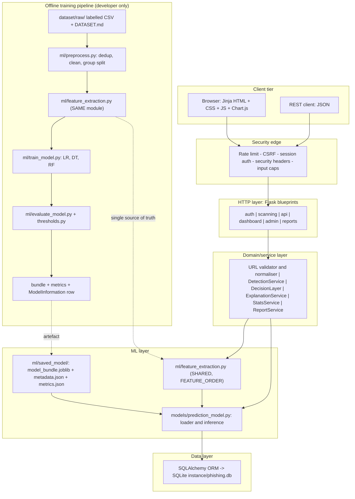

# System Architecture — Intelligent Phishing Website Detection System

**Document status:** Stage 1 design contract, kept current with implementation notes through **Stage 7** (last updated 2026-11-04)
**Audience:** final-year Computer Science student, project supervisor, examiner
**Scope of this document:** architecture and the design contract. The Stage 1 prose deliberately describes the *planned* system; numbered "implementation note" paragraphs record what has actually been built since. Stages 2–7 are delivered; Stages 8–14 remain planned. Measured performance figures live only in `ml/saved_model/metrics.json` and the generated `docs/EVALUATION.md` / `docs/MODEL_CARD.md`.

---

## 1. Purpose and scope of Stage 1

Stage 1 produces a **design contract**: a precise description of every component, the interfaces between them, the data flows, the security boundaries and the order in which the system will be built. It is necessary because this project has a specific academic risk: it is easy to build an attractive website with hand-written `if "login" in url: phishing` rules and call it "machine learning". The architecture below makes that impossible by construction — the only thing that can produce a verdict is a trained, persisted estimator, and the same feature extractor is used offline and online.

Stage 1 deliverables:

| File | Purpose |
| --- | --- |
| `docs/ARCHITECTURE.md` | This document — the complete system design |
| `docs/DECISIONS.md` | Architecture Decision Records (the "why") |
| `docs/STAGE_PLAN.md` | The 14-stage roadmap with exit gates |
| `docs/diagrams/architecture.svg` | Offline-renderable architecture diagram (no CDN, no scripts) |
| `docs/diagrams/architecture.png` | PNG export of the same diagram for Word/PowerPoint report chapters |
| `scripts/verify_stage1.py` | Executable Stage 1 exit gate |
| `README.md`, `.gitignore`, empty directory skeleton | Repository foundation |

**Explicitly not in Stage 1:** `requirements.txt` (Stage 2), datasets (Stage 3), feature code (Stage 4), models (Stages 5–6), Flask (Stage 7), templates (Stage 9).

---

## 2. System context and trust boundaries

### 2.1 Actors

| Actor | Capabilities |
| --- | --- |
| Guest / anonymous visitor | Read landing page, submit a URL for scanning, see the result |
| Registered user | All of the above + personal scan history, report download, CSV export |
| Administrator | All of the above + user totals, system-wide statistics, model performance view, recent activity |
| Offline operator (you, the developer) | Runs the training pipeline; is the only actor that touches `dataset/raw/` and `ml/saved_model/` |
| REST client | Calls `POST /api/v1/scan` with session/token authentication |

### 2.2 External systems

**None in version 1.** This is the single most important security decision in the project. The backend **never** opens a connection to a submitted URL. It does not resolve DNS, follow redirects, download HTML, render JavaScript or call a reputation API. Analysis is purely lexical (`urllib.parse` + string statistics) plus a local scikit-learn estimator.

Consequences:

- **No SSRF surface.** A user cannot make the server request `http://169.254.169.254/...`, `file://...`, an internal admin panel or any other arbitrary target.
- **No exposure to live malicious sites.** This satisfies the testing constraint "do not test using live malicious websites".
- **No network dependency at runtime.** Scans work offline and are fast and deterministic.
- **Honest limitation:** the system cannot detect a compromised legitimate domain, a redirect chain, page content, certificate issues or a freshly registered lookalike domain. This must appear in the project's Limitations chapter.

If a v2 adds reputation lookups, it belongs in a separate, isolated service with an allowlist of API hosts, hard timeouts, response-size caps and no user-controlled URL forwarding. It is out of scope here.

### 2.3 Trust boundaries

```
UNTRUSTED                    BOUNDARY 1                 BOUNDARY 2              TRUSTED
Browser / REST client  ──►  HTTP edge (rate limit,  ──►  Service layer    ──►  SQLite / model
User-supplied string        CSRF, session, schema        Typed, normalised        artefacts
                            validation, length cap)      URL + feature dict
```

Everything crossing Boundary 1 is hostile until validated. Everything crossing Boundary 2 is a bounded, typed Python object. The model artefact is trusted only because the offline operator produced it; its integrity is checked at load time (schema version, feature names, estimator class).

---

## 3. Architectural style

A **layered modular monolith** with two pipelines that share exactly one feature extractor:

1. **Offline training pipeline** (batch, run by the developer, Stages 3–6): raw labelled CSV → preprocessing → feature extraction → model comparison → evaluation → threshold calibration → `model_bundle.joblib` + `metrics.json` + `metadata.json`.
2. **Online inference pipeline** (synchronous HTTP request, Stages 7–12): submitted URL → validation → **the same** feature extraction → `predict_proba` → decision layer → explanation → database write → HTML/JSON response.

Why a modular monolith rather than microservices? It is one deployment unit, one database, one process — appropriate for a final-year project, easy for an examiner to run, and avoids distributed-systems complexity that adds nothing to the research question. The modularity comes from Flask **blueprints** (HTTP layer) and a separate **service layer** (business logic), not from network boundaries.

Why an **application factory** (`create_app()` in `app.py`)? It lets `tests/conftest.py` create an isolated app with a temporary SQLite database and a fake/missing model for testing without touching the real database — essential for the "model loading failure" test.

Why a **service layer** (`services/`, an improvement over the suggested folder structure)? Blueprints should only parse input, authorize, delegate and render. Detection logic in a blueprint is hard to unit-test and impossible to reuse from the REST API. Putting it in `services/detection_service.py` means the web form, the JSON API and the automated tests all call the same function.

### 3.1 High-level diagram (offline-friendly)



A fully self-contained rendered version (no Mermaid extension or internet needed) is in `docs/diagrams/architecture.svg`, with a PNG export at `docs/diagrams/architecture.png` for the report.

### 3.2 ASCII fallback

```
  BROWSER / REST CLIENT
        |  1. POST /scan  or  /api/v1/scan   { url: "..." }
        v
  [ SECURITY EDGE ]  rate limit -> CSRF -> session -> length/scheme validation
        |  2. validated string (max 2048 chars, http/https only)
        v
  [ FLASK BLUEPRINTS ]  scanning.py / api.py / auth.py / dashboard.py / admin.py
        |  3. delegate
        v
  [ SERVICE LAYER ]  normalise -> extract_features -> predict_proba -> decide -> explain
        |                     ^                          ^
        |                     |                          |
        |            ml/feature_extraction.py     model_bundle.joblib
        |            (FEATURE_ORDER, 15 feats)   + metadata.json
        |                     ^                          ^
        |                     |                          |
        |        OFFLINE: CSV -> preprocess -> same extractor -> train -> evaluate -> save
        v
  [ SQLAlchemy ORM ] -> SQLite instance/phishing.db  (User, ScanHistory, ModelInformation)
        |
        v
  4. HTML result page / JSON response / downloadable report / CSV export
```

---

## 4. Component view

| # | Component | Path | Responsibility | Introduced |
| --- | --- | --- | --- | --- |
| C1 | App factory | `app.py`, `wsgi.py` | Create app, register blueprints, init extensions, error handlers | Stage 7 |
| C2 | Configuration | `config.py`, `.env` | Dev/Test/Prod classes, secrets from environment | Stage 2/7 |
| C3 | Auth blueprint | `routes/auth.py` | Register, login, logout, password hashing, sessions | Stage 7/12 |
| C4 | Scan blueprint | `routes/scanning.py` | Web form, result page, report download, copy-to-clipboard data | Stage 10 |
| C5 | Dashboard blueprint | `routes/dashboard.py` | KPIs, charts, recent scans | Stage 11 |
| C6 | History blueprint | `routes/dashboard.py` (history view) | Filter/search/paginate scans, CSV export | Stage 11 |
| C7 | Admin blueprint | `routes/admin.py` | Users, system totals, model performance | Stage 11/12 |
| C8 | API blueprint | `routes/api.py` | `POST /api/v1/scan`, `GET /api/v1/model/info` | Stage 12 |
| C9 | URL validator/normaliser | `services/validation.py` | Scheme allowlist, length cap, safe canonical string | Stage 4/10 |
| C10 | Detection service | `services/detection_service.py` | Orchestrates steps 1–7 of a scan | Stage 10 |
| C11 | Decision layer | `services/decision_service.py` | Maps model score to one of three states using calibrated thresholds | Stage 6/10 |
| C12 | Explanation service | `services/explanation_service.py` | Flagged features, human-readable reasons, recommended action | Stage 10 |
| C13 | Stats/report services | `services/stats_service.py`, `report_service.py` | Aggregations, PDF/HTML/text report, CSV export | Stage 11 |
| C14 | Feature extractor | `ml/feature_extraction.py` | **Single source of truth** for the 15 features | Stage 4 |
| C15 | Preprocessing | `ml/preprocess.py` | Dedup, missing/invalid removal, normalisation, label encoding, leakage-safe split | Stage 3 |
| C16 | Training | `ml/train_model.py` | Fit and compare Logistic Regression, Decision Tree, Random Forest | Stage 5 |
| C17 | Evaluation/calibration | `ml/evaluate_model.py`, `ml/thresholds.py` | Metrics, confusion matrix, ROC-AUC, threshold selection | Stage 6 |
| C18 | Inference wrapper | `models/prediction_model.py` | Load bundle, validate schema, `predict_proba`, explicit failure mode | Stage 10 |
| C19 | ORM models | `models/database_models.py` | `User`, `ScanHistory`, `ModelInformation` | Stage 8 |
| C20 | Templates/static | `templates/`, `static/` | Jinja2 pages, CSS themes, JS, vendored Bootstrap/Chart.js | Stage 9 |
| C21 | Tests | `tests/` | Feature, model, route, API, security, failure tests | Stage 13 |

### 4.1 Improvements to the suggested folder structure (and why)

| Addition | Reason |
| --- | --- |
| `services/` | Keeps HTTP blueprints thin; detection logic becomes unit-testable and reusable by the REST API |
| `routes/api.py` | Separates the JSON contract from HTML form handling; different CSRF/auth/error semantics |
| `wsgi.py` | Production entry point (gunicorn/waitress) without changing `app.py` |
| `static/vendor/` | Bootstrap 5 and Chart.js are vendored locally instead of loaded from a CDN — works offline, keeps CSP strict, and the in-app file viewer has no network access anyway |
| `docs/diagrams/`, `docs/DECISIONS.md` | UML diagrams and ADRs need a home; examiners ask for design rationale |
| `scripts/` | `verify_stage1.py`, `init_db.py`, `create_admin.py` — operational scripts are not application code |
| `tests/conftest.py` | Shared fixtures for isolated app/database/model |
| `.env.example` | Documents required secrets without committing them |
| `ml/saved_model/metadata.json`, `metrics.json` | Machine-readable model card; the dashboard reads these rather than hard-coded numbers |
| `templates/errors/` | Custom 400/404/429/500 pages that never leak stack traces |

---

## 5. Communication and data flows

### 5.1 Flow A — offline training (run once, then repeated when the dataset changes)

1. Operator places a **real, cited, labelled** CSV in `dataset/raw/` and records source, URL, licence, collection date and class counts in `docs/DATASET.md`.
2. `ml/preprocess.py` reads it, drops nulls and invalid URLs, normalises URLs, removes exact duplicates **and near-duplicates** (same registrable domain + same path signature), encodes labels (`0 = legitimate`, `1 = phishing`), reports class distribution, then performs a **group-aware** train / validation / test split so that near-identical URLs can never land in two different splits.
3. `ml/feature_extraction.py` converts each URL into a fixed-order numeric vector; the same function is imported by the training script and by the running web app.
4. `ml/train_model.py` fits three scikit-learn `Pipeline` objects (scaler where needed + Logistic Regression, Decision Tree, Random Forest) on the **training split only**.
5. `ml/evaluate_model.py` scores all three on the **validation split**, computes accuracy, precision, recall, F1, confusion matrix and ROC-AUC, and selects the winner by a documented, recall-sensitive criterion (see §6).
6. `ml/thresholds.py` calibrates the abstention band on the validation split. The **test split is touched exactly once**, for the final reported numbers.
7. The winner (plus `FEATURE_ORDER`, schema version, thresholds, training date, dataset fingerprint and metrics) is written to `ml/saved_model/`. `scripts/init_db.py` / a training hook upserts one `ModelInformation` row from `metrics.json`.

**No metric is typed into a template.** Every number shown in the UI comes from `metrics.json` or the database.

### 5.2 Flow B — one online scan (the core runtime path)

| Step | Component | Input → output |
| --- | --- | --- |
| 1 | Edge middleware | Raw form field / JSON → bounded string; reject if empty, > 2048 chars, or scheme not in `{http, https}` |
| 2 | `services/validation.py` | Bounded string → canonical normalised URL (lowercase host, default scheme filled, no credential component retained in display). **No DNS, no socket, no `requests`** |
| 3 | `ml/feature_extraction.py` | Normalised URL → `dict[str, int]` of exactly 15 features in `FEATURE_ORDER` |
| 4 | `models/prediction_model.py` | Feature dict → `p = predict_proba(X)[0][1]`, the model score for the phishing class; schema/version checked first |
| 5 | `services/decision_service.py` | `p` + thresholds from `metadata.json` → `LEGITIMATE | SUSPICIOUS | PHISHING` + `LOW | MEDIUM | HIGH` risk |
| 6 | `services/explanation_service.py` | Feature dict + global feature importance → flagged characteristics, plain-language reasons, recommended action, uncertainty note |
| 7 | `services/detection_service.py` → ORM | One `ScanHistory` row (URL, prediction, model score, risk level, UTC timestamp, nullable `user_id`, model version) |
| 8 | Blueprint | HTML result page **or** JSON response; report/CSV generated from the stored row, never by re-scanning |

**Failure path (must be explicit):** if the bundle is missing, corrupt, version-mismatched or lacks `predict_proba`, the loader raises `ModelUnavailableError`; the app returns a clear "Detection model unavailable — contact the administrator" state (HTTP 503 for the API) and logs the error. It must **never** silently fall back to hand-written rules, because that would misrepresent the system as ML-driven.

### 5.3 Flow C — supporting flows

- **Authentication:** register → validate → hash password (Werkzeug `generate_password_hash`, scrypt/PBKDF2) → insert `User`; login → `check_password_hash` → `session.regenerate`/fixed session ID → `SESSION_COOKIE_HTTPONLY`, `SAMESITE=Lax`, `SECURE` in production.
- **Dashboard/history/admin:** `StatsService` issues ORM aggregate queries (`func.count`, `group_by`) → blueprint passes plain Python values to Jinja → Chart.js renders from an inline JSON payload. No SQL string concatenation anywhere.
- **Reports:** `GET /scan/<id>/report` re-reads the stored row, renders a printable HTML/text report; CSV export streams the filtered query with formula-injection neutralisation (prefix leading `= + - @` with an apostrophe).
- **Theme toggle:** `static/js/main.js` sets `data-theme` on `<html>` and persists the choice in `localStorage`; CSS variables in `static/css/themes.css` handle both palettes.

---

## 6. Machine-learning decision architecture

This section is the academic heart of the design. Read it carefully.

### 6.1 The model is binary; "Suspicious" is an abstention decision, not a trained third class

Reputable phishing URL datasets label examples as **phishing** or **legitimate**; they do not contain a reliably labelled "suspicious" class. Training a 3-class classifier would therefore require inventing labels — a fabrication that would invalidate the project. Instead:

- The estimator is a **binary** classifier, `P(phishing | URL features) = p`.
- A **decision layer with an uncertainty band** converts `p` into the three requested result states. This is standard *selective prediction / abstention*: when the model is not confident enough, it declines to give a binary verdict and the system says so honestly.

```
p >= T_high   ->  PHISHING      (risk HIGH)     "Potential phishing website detected."
p <= T_low    ->  LEGITIMATE    (risk LOW)      "No phishing indicators detected by this model."
T_low < p < T_high -> SUSPICIOUS (risk MEDIUM)  "This website requires further investigation."
```

**Provisional defaults:** `T_low = 0.30`, `T_high = 0.70`. These are declared now as a *conservative starting band*, not as measured or optimal values. They live in `config.py` as fallbacks only; the runtime values always come from `metadata.json`.

**Stage 6 implementation note (measured):** `ml/thresholds.py` implements the grid search and `DECISION_STATES` (exact UI strings, colours, risk levels and warnings); `ml/evaluate_model.py` measures all candidates on validation, selects a winner, calibrates the band, scores the test split once and writes `model_bundle.joblib`, `metadata.json`, `metrics.json`, `docs/MODEL_CARD.md` and `docs/EVALUATION.md`. The selected thresholds, measured abstention rate and all performance figures are in those artefacts — no value is hard-coded in application code. `verify_stage6.py` independently recomputes every published metric.

**How the final thresholds are selected (Stage 6, measured, not assumed):** on the **validation split only**, `ml/thresholds.py` grid-searches candidate `(T_low, T_high)` pairs and selects the pair that (1) satisfies a documented recall constraint for the phishing class on non-abstained predictions (a missed phishing site is the costliest error), (2) then maximises F1 on non-abstained predictions, (3) tie-breaks by lowest false-negative count, and (4) reports the resulting **abstention rate** so the band cannot be made uselessly wide. The chosen values, the criterion, the validation split size and the abstention rate are written to `metadata.json` and displayed in the model-performance view. The test split is used once afterwards for the final reported metrics. This is the documented justification for the "explicitly defined uncertainty threshold" requested in the brief.

### 6.2 Wording of the score (a correctness requirement)

The UI must never say "there is a 93% chance this site is malicious". It says:

> **Model score: 0.93** — the model's uncalibrated estimate of `P(phishing | URL features)`, computed by `predict_proba` on 15 lexical URL features. It is **not** a calibrated probability that the website is malicious, and it is not a guarantee.

For `SUSPICIOUS`, the UI adds: "The score falls inside the uncertainty band; the model is abstaining. Treat this as *unresolved*, not as a 50/50 probability." For `LEGITIMATE`, the UI adds the required warning that a legitimate classification does not guarantee safety.

### 6.3 Explainability (without over-claiming)

Two honest layers, both labelled as *indicators*, never as proof:

1. **Per-scan flagged features:** which of the 15 characteristics were present (e.g. `@` symbol, IP-address host, suspicious keyword, unusual port, encoded characters). These are descriptive facts about the string.
2. **Global feature importance:** from the fitted Random Forest `feature_importances_`, or permutation importance computed on the validation set for any model type. Displayed on the model-performance view as "features the model relied on overall".

The UI must state that these are correlations learned from the training distribution, not causation, and that a single flagged feature does not make a site malicious. No unsupported claim such as SHAP causality will be made unless actually implemented and measured.

---

## 7. Feature contract

`ml/feature_extraction.py` exports:

```python
FEATURE_ORDER: tuple[str, ...]          # exactly 15 names, immutable order
FEATURE_DEFINITIONS: dict[str, str]     # academic description of each feature
def extract_features(url: str) -> dict[str, float]: ...
def features_to_frame(features: dict[str, float]) -> pd.DataFrame: ...
```

| # | Feature | Meaning | Why it can indicate phishing |
| --- | --- | --- | --- |
| 1 | `url_length` | Total characters in the normalised URL | Very long URLs hide the real domain behind padding and query junk |
| 2 | `domain_length` | Length of the host | Long, keyword-stuffed hosts impersonate brands |
| 3 | `num_dots` | Count of `.` | Many dots create fake subdomain chains (`brand.com.login.evil.tld`) |
| 4 | `num_hyphens` | Count of `-` | Hyphenated lookalike domains (`secure-paypal-verify`) |
| 5 | `num_special_chars` | Count of non-alphanumeric URL characters | Obfuscation and delimiter abuse |
| 6 | `num_digits` | Count of digits | Digit-heavy hosts/paths are common in generated phishing kits |
| 7 | `has_ip_address` | Host is a literal IPv4/IPv6 address | Legitimate brands almost never use bare IPs as the visible host |
| 8 | `has_at_symbol` | `@` present in URL | Everything before `@` is userinfo; the real host is after it — a classic deception |
| 9 | `has_suspicious_pattern` | Lexical patterns such as repeated slashes, brand-in-subdomain, excessive dots | Structural obfuscation |
| 10 | `num_subdomains` | Labels in the host beyond the registrable domain | Deep subdomain chains disguise the true destination |
| 11 | `has_https` | Scheme is `https` | A weak feature: most phishing now uses HTTPS. **HTTPS alone never means legitimate.** Included so the model can learn its true (low) weight |
| 12 | `is_shortened` | Host in a maintained list of URL shorteners | Shorteners hide the final destination |
| 13 | `num_suspicious_words` | Occurrences of `login`, `verify`, `update`, `secure`, `account`, `banking`, `confirm` | Credential-harvesting lures |
| 14 | `has_unusual_port` | Explicit port outside `{80, 443}` (or absent) | Non-standard ports on throwaway hosting |
| 15 | `has_encoded_chars` | `%xx` escapes, double encoding | Encoded characters conceal the true path or hostname |

**Contract rules:**

- Pure function: no I/O, no network, no randomness, no global state. Deterministic for the same input.
- All values numeric (`int`/`float`); booleans stored as `0`/`1` so every estimator accepts them.
- `FEATURE_ORDER` is the **only** authority on column order. Training and inference both call `features_to_frame()`; a mismatch is a hard error, never a silent reindex.
- The same `normalize_url()` — implemented once in `ml/url_utils.py` (Stage 3) — is used in preprocessing and for live input; otherwise training and production would see different strings (a subtle, very common bug called *training–serving skew*). It is pure standard library, performs no network I/O, and enforces the 2,048-character limit and the `http`/`https` scheme allowlist. `services/validation.py` (Stage 4) is the live trust boundary that wraps it.
- This contract is **implemented** in `ml/feature_extraction.py` (Stage 4) with `FEATURE_ORDER`, `extract_features`, `features_to_frame` and `extract_frame`; precise definitions, worked examples and measured class-conditional statistics are in `docs/FEATURES.md` and `dataset/processed/feature_summary.json`. Stage 5 training and Stage 10 inference must both import that module — there is no second feature implementation.
- `docs/DATASET.md` and the Stage 4 doc will restate each feature with worked examples.

---

## 8. Model artefact contract

`ml/saved_model/` contains:

| File | Contents |
| --- | --- |
| `model_bundle.joblib` | `{"estimator": fitted sklearn Pipeline, "feature_order": [...], "schema_version": "1.0", "model_name": ..., "model_version": ...}` |

**Stage 5 implementation note:** `ml/train_model.py` already produces three *unselected* candidate bundles in `ml/saved_model/candidates/` (`logistic_regression.joblib`, `decision_tree.joblib`, `random_forest.joblib`) with the same `feature_order` / `schema_version` fields plus `hyperparameters`, `training_rows`, `training_seconds` and `library_versions`; `training_manifest.json` records them. Those are **not** the deployable artefact. Stage 6 selects one and writes the final `model_bundle.joblib`, `metadata.json` and `metrics.json`. No metric is computed before Stage 6.
| `metadata.json` | `T_low`, `T_high`, threshold selection criterion and validation abstention rate, training timestamp, dataset fingerprint, class distribution, library versions |
| `metrics.json` | Measured accuracy, precision, recall, F1, ROC-AUC, confusion matrix, per-model comparison table, split sizes |

`models/prediction_model.py` validates the bundle at startup: schema version, `FEATURE_ORDER` equality, presence of `predict_proba`, and class index for `1`. On any failure it raises `ModelUnavailableError`. The dashboard reads `metrics.json`/`ModelInformation`; **no performance number is hard-coded in a template, a JS file or a Markdown results table**. Until Stage 6 has run, the UI shows "Model not trained yet", not a fake 98%.

---

## 9. Data architecture

### 9.1 Entities and relationships (ER)

```
+-------------------+          +---------------------------+          +------------------------+
|      User         |          |       ScanHistory         |          |   ModelInformation     |
+-------------------+          +---------------------------+          +------------------------+
| PK id             | 1    0..*| PK id                     |          | PK id                  |
|    username  UQ   |---------<| FK user_id  NULLABLE      |          |    model_name          |
|    email     UQ   |          |    url (bounded 2048)     |          |    model_version       |
|    password_hash  |          |    normalised_url         |          |    training_date       |
|    role           |          |    prediction             |          |    accuracy            |
|    created_at UTC |          |    model_score  REAL      |          |    precision           |
+-------------------+          |    risk_level             |          |    recall              |
                               |    model_version          |          |    f1_score            |
                               |    scan_date  UTC, INDEX  |          |    roc_auc             |
                               +---------------------------+          |    dataset_fingerprint |
                                                                      +------------------------+
```

- `User (1) ── (0..*) ScanHistory`: `user_id` is **nullable** so guest scans are preserved; `ON DELETE SET NULL` keeps history if an account is deleted. Decision to confirm with the user before Stage 8 (see §17).
- `ScanHistory.prediction` is constrained to `LEGITIMATE | SUSPICIOUS | PHISHING` (application-level `CheckConstraint`), likewise `risk_level` to `LOW | MEDIUM | HIGH`.
- Indexes: `scan_date`, `prediction`, `user_id`, and a composite `(user_id, scan_date)` for history paging.
- `ModelInformation` is written by the training pipeline, read by the admin dashboard. It is an audit record, not a cache of invented values.
- Timestamps are UTC (`datetime.now(timezone.utc)`), rendered in local time in the template.

### 9.2 Database security

SQLAlchemy ORM with bound parameters only (SQL-injection defence), no raw string SQL, least-privilege SQLite file under `instance/` (outside the web root), secrets in `.env`, `password_hash` never logged or serialised, URL length capped before storage, Jinja2 autoescaping on display (XSS defence), CSV export neutralises spreadsheet formula injection.

---

## 10. Security architecture

| Requirement | Mechanism | Stage |
| --- | --- | --- |
| Input validation | Scheme allowlist `{http, https}`, 2048-char cap, `urllib.parse` validation, typed feature dict | 4/10 |
| SSRF prevention | **Zero outbound requests**; no `requests`/`socket`/DNS in the scan path; no redirects; no file:// or non-HTTP schemes. Enforced also by a test that asserts no network module is imported by detection code | 10/13 |
| SQL injection | SQLAlchemy ORM + bound parameters; no f-string SQL | 8/11 |
| CSRF | Flask-WTF `CSRFProtect` on all state-changing POST routes; token in forms and `X-CSRF-Token` for AJAX; API token alternative documented | 12 |
| Password hashing | `werkzeug.security.generate_password_hash` (scrypt); constant-time verification; never plaintext | 7/12 |
| Session management | Signed session cookie, `HTTPONLY`, `SAMESITE=Lax`, `SECURE` in prod, session ID rotation on login, logout clears session | 7/12 |
| Rate limiting | Flask-Limiter on `/scan`, `/api/v1/scan`, `/login`, `/register` (e.g. per-IP + per-user keys) | 12 |
| XSS | Jinja2 autoescape, no `|safe` on user input, strict CSP with locally vendored assets, no inline user data in `<script>` | 9/12 |
| Secure error handling | Custom 400/404/429/500/503 pages, generic messages, stack traces only to server logs, no debug mode in production | 7/12 |
| Secrets | `SECRET_KEY`, database URI and admin bootstrap credentials from environment variables via `.env`; `.env` gitignored; `.env.example` committed | 2/7 |
| Artefact integrity | Bundle schema/version/feature-order validation; load failure is explicit, not a silent fallback | 10 |
| Safe testing | Only synthetic, controlled URL strings; no live malicious sites are ever contacted | 13 |

---

## 11. HTTP and API contracts

| Method | Path | Auth | Purpose |
| --- | --- | --- | --- |
| GET | `/` | none | Landing page, hero scan box, how-it-works, features |
| GET/POST | `/scan` | optional + CSRF on POST | Scan form and result page |
| GET | `/scan/<id>/report` | owner or admin | Downloadable report |
| GET | `/history` | login | Filter/search/paginate scans |
| GET | `/dashboard` | login | KPI cards + classification charts |
| GET | `/admin` | admin role | Users, totals, model performance, recent activity |
| GET/POST | `/login`, `/register`, `/logout` | CSRF on POST | Authentication |
| POST | `/api/v1/scan` | session/token + CSRF or bearer | JSON detection |
| GET | `/api/v1/model/info` | session/token | Model card and measured metrics |
| GET | `/history/export.csv` | login | CSV export of filtered history |

`POST /api/v1/scan` request/response shape (field names are the contract, implemented in Stage 12):

```json
// request
{ "url": "https://example.com/login?next=account" }

// 200 response (illustrative SHAPE ONLY - no numbers here are measured results)
{
  "scan_id": 42,
  "submitted_url": "...", "normalized_url": "...",
  "prediction": "SUSPICIOUS",
  "model_score": 0.58,
  "score_meaning": "Uncalibrated model estimate of P(phishing | URL features); not a probability that the site is malicious",
  "risk_level": "MEDIUM",
  "decision_band": { "low": 0.30, "high": 0.70, "source": "validation-calibrated in metadata.json" },
  "flagged_features": ["has_at_symbol", "num_suspicious_words"],
  "recommended_action": "Do not enter credentials; verify the domain independently.",
  "scanned_at": "2026-11-03T10:15:00Z",
  "model": { "name": "...", "version": "..." }
}
```

Error contract: `400 INVALID_URL`, `401 UNAUTHENTICATED`, `403 FORBIDDEN`, `429 RATE_LIMITED`, `503 MODEL_UNAVAILABLE`, `500 INTERNAL_ERROR` (generic). Errors are JSON for `/api/*`, HTML pages otherwise. A `503` is a legitimate, honest result — never a rule-based guess disguised as a 200.

---

## 12. Configuration and deployment view

- `config.py`: `DevelopmentConfig`, `TestingConfig`, `ProductionConfig`; `SECRET_KEY` and `DATABASE_URL` read from environment; `SQLALCHEMY_DATABASE_URI` defaults to `sqlite:///phishing.db` inside `instance/`.
- Development: `flask --app app run --debug` bound to `0.0.0.0` when a live preview is needed; debug **off** whenever the app is reachable from outside the sandbox.
- Testing: in-memory or temporary-file SQLite, `TESTING=True`, `WTF_CSRF_ENABLED=False` where a test needs it, model bundle injected via fixture.
- Production (optional, Stage 14): `gunicorn`/`waitress wsgi:app`, `SECURE=True`, reverse proxy TLS, SQLite file outside the static root, no network egress required.
- Frontend assets are **vendored locally** in `static/vendor/` so the UI works in offline/restricted environments and the CSP can disallow third-party origins.

**Stage 7 implementation note (measured against the gate):** `create_app()` in `app.py` consumes these config classes and re-validates the *effective* `app.config` after test overrides. `extensions.py` holds the four shared singletons (`db`, `csrf`, `login_manager`, `limiter`) so Stage 8's ORM models cannot create a circular import. `wsgi.py` exposes `app`, `application` and `create_application()` for waitress/gunicorn. `routes/core.py` serves `GET /` (a backend status page, **not** the product landing page) and `GET /health`; `routes/auth.py` supplies the working session/CSRF surface. `services/http_security.py` installs a strict CSP, hardening headers, generic JSON/HTML error responses and a `MAX_CONTENT_LENGTH` guard. `services/model_metadata.py` validates `metadata.json` against `ml/thresholds.py` and checks the bundle's SHA-256: bad metadata refuses startup, a missing/corrupt bundle yields `503 MODEL_UNAVAILABLE` instead of a rule-based guess. The status page and health response contain **no performance figure**; Stage 11 will read `metrics.json` at runtime. `config.py` gained `BUILD_STAGE`, `HOST`, `PORT` and the frame policy (ADR-025): strict framing in production, omitted in development so the cross-origin live-preview iframe renders. There is no `"SCAN WEBSITE"` button, no `/login` form, no ORM entity and no `instance/phishing.db` yet — those are Stages 8–10 (ADR-024). Full details: `docs/BACKEND.md`.

---

## 13. Quality attributes, trade-offs and limitations

| Attribute | Design response |
| --- | --- |
| Detection quality | Recall is prioritised (false negatives are the dangerous error); thresholds tuned under a recall constraint; model chosen by measured F1/recall on validation, not by name |
| Academic defensibility | Cited dataset, documented splits, no leakage, no fabricated numbers, reproducible training script, model card, ADRs |
| Explainability | Feature definitions, flagged indicators, global importance, explicit uncertainty wording |
| Security | No network fetching, layered input validation, ORM, CSRF, hashing, rate limiting, safe errors |
| Maintainability | Blueprints + services + one shared feature module + versioned artefact contract |
| Usability | Three visually distinct result states, responsive dark/light themes, history, exports |
| Performance | Pure string features and a local estimator: sub-second scans, no I/O beyond one DB insert |

**Accepted limitations (must appear in the final report):** static URL-only analysis cannot inspect page content, redirects, DNS age, certificates or domain reputation; performance depends entirely on the quality and representativeness of the chosen dataset; `SUSPICIOUS` is an abstention, not a third ground-truth class; URL shorteners and newly registered lookalikes can evade lexical features; the model is not a guarantee of safety and must not replace user judgement or dedicated security tooling.

---

## 14. Stage roadmap and exit gates

The full table (files, commands, tests, exit criteria) is in `docs/STAGE_PLAN.md`. Summary:

| Stage | Build | Gate |
| --- | --- | --- |
| 1 | Planning and architecture (Stage 1 design contract; still the reference) | `scripts/verify_stage1.py` passes; you approve the design |
| 2 | Environment, `requirements.txt`, config | Clean venv, `pip check`, `flask --version` |
| 3 | Dataset acquisition + `preprocess.py` | Real cited CSV, provenance doc, class counts, leakage-free split |
| 4 | `feature_extraction.py` + `validation.py` | Unit tests for all 15 features; identical train/live output |
| 5 | `train_model.py`, three models | Three fitted pipelines, no errors |
| 6 | `evaluate_model.py`, thresholds, artefact | Measured metrics saved; best model selected; no hard-coded stats |
| 7 | Flask factory + blueprints | App boots, routes respond |
| 8 | ORM + SQLite | Tables created, CRUD tests pass |
| 9 | Templates, CSS, JS, charts | Responsive pages render in both themes |
| 10 | Detection engine integration | End-to-end scan works; model-failure path tested |
| 11 | Dashboard, history, admin, exports | Aggregates match DB; charts and CSV correct |
| 12 | Security hardening + REST API | CSRF/rate-limit/hash/header/API tests pass |
| 13 | Full automated test suite | `pytest` green; no live malicious URLs |
| 14 | Documentation, UML, model card, deployment | Report complete; clean production start |

---

## 15. Stage 1 test plan

An architecture cannot be "unit tested" like a function, so the gate verifies **structure, internal consistency and stage discipline**:

```bash
cd phishing-detection-system
python scripts/verify_stage1.py
```

The script checks: Python ≥ 3.10, all required directories/files exist and are non-empty, all required architecture sections are present, the SVG parses as well-formed XML with no external references, `.gitignore` protects secrets and the database, no later-stage `*.py` files have been started early, and no placeholder markers exist in Stage 1 code. It exits `1` on any failure.

Human review checklist (you should tick these before saying "go to Stage 2"):

- [ ] I can explain why there are two pipelines and one shared feature extractor.
- [ ] I can explain why "Suspicious" is an abstention band rather than a trained third class.
- [ ] I understand that `T_low`/`T_high` will be **measured** in Stage 6 and that no accuracy figure is claimed yet.
- [ ] I understand why the backend never fetches a submitted URL.
- [ ] I agree with the dataset decision in §17 (I must supply/choose a real labelled source).

---

## 16. Common errors and fixes

| Symptom | Cause | Fix |
| --- | --- | --- |
| `python: command not found`, but `python3` works | Windows/macOS alias difference | Use `python3 scripts/verify_stage1.py`, or `py -3` on Windows |
| `can't open file 'scripts/verify_stage1.py'` | Wrong working directory | `cd phishing-detection-system` first; the script resolves its own root from `__file__` |
| `FAIL dir instance/` | Folder deleted, or `.gitkeep` lost in a Git clone | `mkdir -p instance && touch instance/.gitkeep` |
| Mermaid diagram shows as raw text | The in-app file preview has no JS/CDN | Open `docs/diagrams/architecture.svg`, or view the Markdown in VS Code with a Mermaid extension |
| `SyntaxError` in `verify_stage1.py` | Python < 3.10 (uses `list[str]`, `dict[str, str]`) | Install Python 3.10+; check with `python3 --version` |
| Empty directories missing after `git clone` | Git does not track empty directories | The `.gitkeep` files in each empty directory prevent this |
| Temptation to add a `98% accurate` badge now | Enthusiasm | Don't. Stage 6 writes real numbers to `metrics.json`; the UI reads them from there |

---

## 17. Open decisions

These do **not** block Stage 1, but should be settled before Stage 2/3:

1. **Dataset source.** PhishTank and OpenPhish provide *phishing* URLs but not the legitimate class, so a benign list (e.g. a ranked top-domains list) must be paired with them and documented. The **UCI "Phishing Websites" dataset contains 30 pre-computed features, not raw URLs** — it cannot be used with a URL-based feature extractor without fabricating URLs. A raw-URL academic CSV (URL + label) is the correct input. You must choose and download a real, citable dataset in Stage 3; I will not invent one.
2. **Delivery mode.** Should each stage be built as real files in this workspace (with a live preview) and/or pasted as complete code blocks for your own VS Code project?
3. **Guest scans.** Should anonymous visitors be allowed to scan (nullable `user_id`), or must every scan belong to a logged-in user?
4. **Local environment.** Your OS and Python version, so Stage 2 commands are exact (this workspace has Python 3.13.16).

---

---

## 18. Stage 8 implementation note (measured against the gate)

**Stage 8 implementation note.** The §9 ER contract is now real code. `models/database_models.py` defines `User`, `ScanHistory` and `ModelInformation`; `ScanHistory.user_id` is nullable and the FK uses `ON DELETE SET NULL`, so deleting an account anonymises but preserves its scan history and guest scans remain first-class. `configure_database(app)` installs an engine-scoped SQLite `connect` listener issuing `PRAGMA foreign_keys=ON`, because SQLite otherwise ignores that clause. CHECK constraints enforce `role`, `prediction ∈ {LEGITIMATE, SUSPICIOUS, PHISHING}`, `risk_level ∈ {LOW, MEDIUM, HIGH}`, `model_score ∈ [0,1]` and `length(url) ≤ 2048`; indexes cover `scan_date`, `prediction`, `user_id` and the composite `(user_id, scan_date)`. All timestamps are UTC-aware with `utc_value()` normalising SQLite's naive reads.

`services/auth_service.py` owns validation, salted **scrypt** hashing, timing-equalised authentication and the fail-closed `user_loader`; `services/database_service.py` owns schema bootstrap, live status inspection and idempotent seeding of `model_information` from the **measured** `metrics.json` values (ADR-027). `scripts/init_db.py` is the only schema creator and creates no accounts; `scripts/create_admin.py` is the only path to an administrator. Booting a Flask app still has no `create_all()` side effect.

`routes/auth.py` now serves `GET/POST /login` and `GET/POST /register` over both HTML forms and JSON, rotates the session before `login_user()`, ignores any client-supplied `role`, and returns `503 DATABASE_UNAVAILABLE` until bootstrap has run. `login_manager.login_view = "auth.login"` is set, but the Stage 7 `unauthorized_handler` still returns `401 UNAUTHENTICATED` because Flask-Login calls that callback first (ADR-026). `/` and `/health` report the real schema state — table names and row counts only, **never** a performance figure — and still contain no `"SCAN WEBSITE"` button. There are no `templates/*.html`, no `/scan`, no `predict_proba` and no Chart.js yet: those are Stages 9–10. Full detail: `docs/DATABASE.md`.

---

## 19. Stage 9 implementation note (measured against the gate)

**Stage 9 implementation note.** Component C20 (`templates/`, `static/`) is now delivered. `templates/base.html` is the single master layout: sticky responsive navbar, local SVG logo, theme toggle with `aria-pressed`, skip link, footer, `aria-live` region and the complete asset list. `index.html` is the product overview (`GET /`), `login.html` / `register.html` / `auth_result.html` are the auth pages, and `errors/error.html` is used by `make_error_response()` for every HTML error. `app.py` gained a context processor publishing `app_name`, `app_version`, `build_stage`, `environment` and `debug`; `routes/core.py`, `routes/auth.py` and `services/http_security.py` no longer contain inline HTML strings.

`static/css/main.css` implements the dark default in `:root` and a full `[data-theme="light"]` override, including Bootstrap's `--bs-*` tokens. `static/js/theme.js` is a small external blocking script in `<head>` that sets `data-theme` before paint (no inline script, so the strict CSP holds); `static/js/main.js` handles the toggle, Chart.js, active navigation and copy feedback. Bootstrap 5.3.3, `bootstrap.bundle.min.js` and Chart.js 4.4.4 are vendored in `static/vendor/` with SHA-256 digests recorded in `static/vendor/README.md` and recomputed by the gate — no CDN, no external font, no outbound request (ADR-028).

The only chart uses real dataset split **row counts** from `metadata.json#dataset.split_sizes` via `ModelRegistry.dataset_chart()`, passed as an escaped `data-chart='{{ split_chart|tojson }}'` attribute and parsed by `main.js`. No measured model result is read or displayed; `/` and `/health` remain free of performance figures (ADR-029). The exact decision-state strings, colours and warnings are rendered from `ml/thresholds.py` at runtime. There is still **no** `/scan` route, no `"SCAN WEBSITE"` button, no dashboard/history/admin templates, no `predict_proba` and no estimator loading — those are Stages 10–11. Full detail: `docs/UI.md`.

*End of architecture document. All measured results live in `ml/saved_model/metrics.json` and `docs/EVALUATION.md`; no figure is duplicated here.*

---

## 20. Stage 10 implementation note (measured against the gate)

Stage 10 closes the gap between the measured model (Stages 3–6), the secure
backend (Stages 7–8) and the interface (Stage 9). Three new layers are added
below the HTTP boundary:

```
routes/scanning.py            GET/POST /scan, GET /scan/<id>/report
        |
services/detection_service.py   DetectionRegistry (app.extensions)
        |            |                 |
        |            |                 +-> extensions.db / ScanHistory (commit before display)
        |            +-> services/decision_service.py  (ml.thresholds.decision_codes)
        |            +-> services/explanation_service.py (measured importance + caveats)
        +-> services/validation.py
                +-> ml.feature_extraction.extract_features (shared 15-feature contract)
                        +-> models/prediction_model.py (hash-verified Joblib estimator)
```

`app.py` constructs the `DetectionRegistry` after `ModelRegistry` has verified
the bundle SHA-256; `/health` now publishes `detection.health()` with
`status`, `feature_count`, `decision_thresholds` and `uncertainty_band`.
`config.py` moves to `APP_VERSION = 0.10.0`, `BUILD_STAGE = 10`;
`routes/__init__.py` registers `scan_bp`.

**Invariants preserved.** The strict CSP and offline vendor hashes are
unchanged; no inline script or style is added; all writes use the ORM; CSRF
covers both HTML and JSON POSTs; `POST/JSON` contracts from Stages 7–8 are
intact; the trained bundle and measured thresholds are not modified. No
measured accuracy/precision/recall/F1/ROC-AUC figure is rendered by the UI.

**New invariants.** The backend performs zero outbound network I/O (no HTTP
client, DNS lookup or socket), so there is no SSRF surface. A missing/corrupt
bundle, missing measured provenance or failed database commit yields an
explicit 503 — never a rule-based guess and never an unlogged result. Guest
scans keep `user_id = NULL`; authenticated scans are linked to `User.id`;
printable reports are access-controlled and rebuilt from the saved row without
re-running inference.

**Deliberate deviation from the original sketch.** The hero scan box is a
prominent "Launch URL scanner" link rather than a duplicate inline form; the
one exact `SCAN WEBSITE` button lives on `/scan`. See ADR-032.

`scripts/verify_stage10.py` re-runs Gates 1–9 and adds the pipeline, parity,
failure-path, SSRF, XSS, CSRF, documentation and dependency checks described in
`docs/DETECTION.md` §12.

---

## §21. Stage 11 implementation note

Stage 11 adds a **read-only reporting layer** above the Stage 10 detection
pipeline. No module in `services/detection_service.py`, `decision_service.py`,
`explanation_service.py` or `models/prediction_model.py` is modified, and the
three decision states, the measured abstention thresholds, the score-meaning
text and the no-network/SSRF rule are unchanged.

```
Browser ──GET──> /dashboard ──> stats_service ──> scan_history (COUNT/GROUP BY)
         │                          └──────────> metrics.json (measured test values)
         ├──GET──> /history ─────> visible_query ─> scoped rows ─> history.html
         ├──GET──> /history/export.csv ─────────> report_service ─> safe CSV
         ├──GET──> /admin ───────> admin_required ─> users + model_information
         └──GET──> /admin/export.csv ───────────> full, admin-only CSV
```

`app.py` registers three new blueprints from `routes/__init__.py`
(`dashboard_bp`, `history_bp`, `admin_bp`) and moves to
`APP_VERSION = 0.11.0`, `BUILD_STAGE = 11`. The global
`401 UNAUTHENTICATED` callback and `login_view` are deliberately untouched.
The response pipeline is still `install_security_headers` →
`install_request_guards` → route → generic error handler; the CSP directive
list is byte-for-byte identical to Stage 9/10.

**Data-flow invariants.** All aggregates are request-time reads. `stats_service`
performs no writes and no raw SQL. `report_service` performs no database
queries at all — it receives only rows already filtered by `export_rows()`.
Jinja autoescaping stays on; every filter is a bound ORM parameter; the
dashboard exposes counts only, never another user's submitted URL.
`static/js/main.js` gains `cycledColours()` so the existing `data-chart`
contract handles seven daily bars without a second JS file, an inline script
or a runtime CDN.

**Failure behaviour.** An uninitialised schema yields
`503 DATABASE_UNAVAILABLE`; a missing or inconsistent measured artefact yields
`503 MODEL_UNAVAILABLE`. Neither path renders plausible-looking zeros.

Stage 12 (`routes/api.py`, per-route rate limits, `docs/SECURITY.md`) is now
delivered as §22 below; it did not change this reporting layer.
`scripts/verify_stage11.py` re-runs Gates 1–10 and checks the dashboard
end-to-end; see `docs/DASHBOARD.md` §12 and ADR-033/034/035.

## 22. Stage 12 implementation note — REST edge and hardening

**Status:** delivered. `0.12.0` / `BUILD_STAGE = 12`; seven blueprints. No new
table, column, migration, secret, template, JS or CSS file.

**New component.** `routes/api.py` registers `api_bp` with prefix `/api/v1` and
six JSON routes: `GET csrf-token`, `GET health`, `GET model/info`,
`POST scan`, `GET scans`, `GET scans/<int:id>`. It is a thin adapter: it calls
`get_detection_registry().scan()` (the exact Stage 10 pipeline used by the HTML
form), reads `stats_service.measured_metrics()` / `history_page()` at request
time, and reuses `can_view_scan()` for authorisation. `DetectionResult` is
projected with `_contract()` into the §11/C8 field names; a stored row is
projected with `_stored_contract()` WITHOUT re-running inference. Every
successful scan writes exactly one `ScanHistory` row; every error uses the
§12 error-code table and `make_error_response`'s `/api/*` JSON negotiation.

**Rate limits (C8 row).** Config-driven, POST-only where relevant, no blanket
`default_limits`. `RATE_LIMIT_AUTH=5 per minute` on `/login` and `/register`;
`RATE_LIMIT_SCAN=10 per minute` on `/scan` and (stacked with a per-account
key) on `/api/v1/scan`; `RATE_LIMIT_API=30 per hour` on the API data endpoints.
`exempt_when=limits_disabled()` reads the effective config, keeping
`TestingConfig` deterministic. Health, CSRF bootstrap, static assets and GET
pages stay unthrottled. A breach is `429 RATE_LIMITED` with `Retry-After`.

**Headers.** `Cross-Origin-Opener-Policy: same-origin`,
`X-Permitted-Cross-Domain-Policies: none`, `Origin-Agent-Cluster: ?1`, and
`Cache-Control: no-store` for `/api/`, `/auth/`, `/health`, `/scan`,
`/history`, `/admin`, `/dashboard` and exports. The CSP directive list from
§9 is UNCHANGED byte-for-byte; no new origin, no inline script/style, no
runtime CDN. Production keeps `X-Frame-Options: DENY`, `frame-ancestors 'self'`
and HSTS; Development/Test still omit them for the live preview (ADR-025).

**Security invariants carried forward.** CSRF protects API POSTs (no exemption,
no bearer token), scrypt hashes and `session.clear()` on login, generic
`401 UNAUTHENTICATED` / `403 FORBIDDEN` / `404 NOT_FOUND`, guest rows with
`user_id=NULL`, ORM-only writes, Jinja autoescaping, UTC timestamps,
formula-safe CSV, exact `SCAN WEBSITE`, three decision states, measured-only
metrics, and ZERO outbound network I/O (no SSRF surface). `503
MODEL_UNAVAILABLE` and `503 DATABASE_UNAVAILABLE` remain honest failures, never
a rule-based guess.

**Verification.** `scripts/verify_stage12.py` checks the full contract with
temporary SQLite databases, a socket-patched SSRF probe, an explicit
429/503/404 matrix, a real local WSGI server, unchanged vendor hashes and
CSP, and Gates 1–11 as regressions. See `docs/SECURITY.md` and
ADR-036/037/038. Stage 13 delivered the formal pytest suite; see §23.

## 23. Stage 13 implementation note — the formal test suite

**Status:** delivered. Tests only: no route, service, model, template, header,
schema or measured figure changed. `APP_VERSION` / `BUILD_STAGE` became
`0.13.0` / `13` so `/health` names the stage whose code is present.

**Shape.** `tests/conftest.py` plus five modules, 203 functions, **259 cases**,
green in about seven seconds:

| Module | Cases | Contract it protects |
| --- | --- | --- |
| `test_features.py` | 73 | `FEATURE_ORDER` (15 names, order), per-feature semantics, fail-closed input, `normalize_url`/`validate_url`, no network imports |
| `test_model.py` | 59 | Metadata + SHA-256 integrity, `PredictionModel` failure modes, the three decision states and their inclusive boundaries, explanation honesty, measured metrics recomputed from `metrics.json`, orchestration and the audit row |
| `test_routes.py` | 46 | `SCAN WEBSITE`, one scan = one row, guest/session visibility, history/CSV scoping, dashboard counts, admin 401/403, auth flows, explicit 503 paths |
| `test_api.py` | 36 | The `/api/v1` field set, UTC timestamps, one pipeline for HTML and JSON, scoped listing, the documented error envelope, JSON 405, `no-store` |
| `test_security.py` | 45 | Exact CSP, hardening headers, production framing/HSTS, CSRF everywhere (incl. `POST /api/v1/scan`), 429 + `Retry-After`, scrypt, escaping, generic 500, SSRF |

**Isolation.** One Flask application per configuration (`TestingConfig`,
CSRF-on, limiter-on, production, missing model, tampered model, no schema,
raising view), each on a temporary SQLite file. `instance/phishing.db` is never
opened. An autouse fixture truncates per-test rows; the limiter's process-wide
in-memory storage is reset around limiting tests.

**Why no `scripts/verify_stage13.py`.** Rule 5 of `docs/STAGE_PLAN.md` has said
since Stage 1 that Stage 13's gate is `pytest`. A thirteenth shell gate would
duplicate it, so `scripts/verify_stage12.py` asserts the file never exists
(ADR-039).

**The SSRF proof is behavioural, not documentary.** `socket.socket`,
`socket.create_connection` and `socket.getaddrinfo` are replaced with functions
that raise; `POST /api/v1/scan` still returns 200 and persists its row, and five
internal targets (`127.0.0.1`, `169.254.169.254`, `10.0.0.1`, `::1`, `localhost`)
are analysed as plain strings. An AST scan of the four verdict-computing modules
confirms no network client is even imported.

**Verification.** `python -m pytest -q` → `259 passed`; `py_compile` clean for
every module and gate; `pip check` clean; Gates 1–12 still `RESULT: PASS`.
Gates 10, 11 and 12 were made Stage 13-aware exactly as they were made Stage
12-aware. See `docs/TEST_PLAN.md` and ADR-039/040/041.

---

## 24. Stage 14 implementation note — documentation, diagrams and deployment

**Status:** delivered. Documentation and deployment only: no route, service, model, template, header,
schema, CSP directive, decision state or measured figure changed. `APP_VERSION` / `BUILD_STAGE` became
`0.14.0` / `14` so `/health` names the stage whose code is present. Route count stays 22, the six test
modules are untouched and still collect 259 cases, and the deployed bundle is still the measured
`logistic_regression` with thresholds `0.05` / `0.95`.

**What was added.** Five UML diagrams (use case, class, sequence, activity, deployment) as hand-authored
SVG; `docs/REPORT.md` (five chapters plus abstract, limitations, conclusion, references and two
appendices); `docs/DEPLOYMENT.md` (topology, install, configuration, database bootstrap, artefact
verification, production start, TLS proxy in nginx and IIS, service definitions, verification
checklist, operations, upgrade/rollback, troubleshooting, security checklist); and
`scripts/verify_stage14.py`.

**How the layers are affected.** They are not. The report and the deployment guide *describe* the
architecture in §3–§5 of `docs/REPORT.md`; they do not extend it. The one structural claim worth
recording is that the deployment topology stays a single process behind a TLS proxy, because rate
limits and the session store are in-process (ADR-037). A second worker would require shared storage for
both, which is listed as future work rather than implemented here.

**Verification model.** Stage 14's exit gate is executable in the same sense as every earlier stage.
`scripts/verify_stage14.py` (128 checks) proves four things:

| Property | Method |
| --- | --- |
| No fabricated numbers in the report | Every 4+ decimal place figure must exist at the same precision in `metrics.json` / `metadata.json` (ADR-042) |
| Diagrams are offline-safe | XML parse, `viewBox`, ≥ 40 elements, no external reference / `<script>` / raster `<image>` / remote font (ADR-043) |
| Clean production start | Real `waitress-serve --call wsgi:create_application` subprocess on a free loopback port; 4 endpoints, 13 runtime properties, one unauthenticated POST rejected with 400, SIGTERM exit with no traceback (ADR-044) |
| Stage discipline | 22 routes, 7 blueprints, unchanged test module set, unchanged model name and thresholds, `BUILD_STAGE = 14` |

**Observed production start** (from the gate's own capture):

```
[2026-11-20 20:17:52,155] INFO in app: Intelligent Phishing Website Detection System v0.14.0 | env=production | model=logistic_regression v1.0.0 | stage=14
INFO:waitress:Serving on http://127.0.0.1:48875
```

`/health` returned `status: ok`, `build_stage: 14`, `bundle.detail: "bundle SHA-256 matches
metadata.json"`, `database.status: "ready"`, `detection.status: "ready"` and thresholds
`{low: 0.05, high: 0.95}`, with `Server: waitress`, the strict CSP, HSTS, `X-Frame-Options: DENY`,
`X-Content-Type-Options: nosniff` and `Referrer-Policy: no-referrer` on every response.
