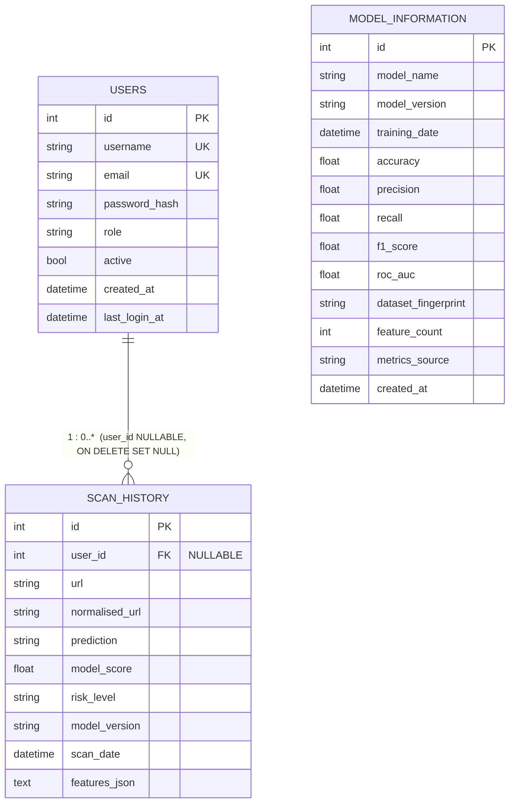

# Stage 8 — Database Integration and Authentication

**Stage rule:** Stage 9 did not start until `python scripts/verify_stage8.py` printed `RESULT: PASS`. Stage 9 has since been delivered.

> **Stage 9 update.** This document describes the Stage 8 persistence layer as shipped; all of it is still true and still gated. Stage 9 changed only presentation: the backend status page, account forms and error pages are now real Jinja2 templates (`docs/UI.md`), vendored Bootstrap/Chart.js and dark/light themes were added, and `config.py` reports `APP_VERSION=0.9.0` / `BUILD_STAGE=9`. The schema, constraints, hashing, bootstrap CLIs, `user_loader`, POST contracts and `503 DATABASE_UNAVAILABLE` behaviour are unchanged. The §8/§10 statements below that "Stage 9+ files are absent" describe the Stage 8 exit condition (historical); `scripts/verify_stage8.py` is stage-aware and skips those checks now.

This document is the complete, stand-alone guide to the Stage 8 persistence layer. It is written for a final-year CS student: every design choice is explained, every command is Windows-first, and every claim is backed by an executable check in `scripts/verify_stage8.py`.

---

## 1. What Stage 8 builds

Before Stage 8 the application had a working Flask factory, security headers, CSRF, sessions and a read-only contract with the Stage 6 model artefacts — but **no persistence**. There was nowhere to store an account, a scan result, or an audit record of which model was deployed.

Stage 8 adds four things and nothing more:

| # | Deliverable | Why it is necessary |
| --- | --- | --- |
| 1 | `models/database_models.py` — `User`, `ScanHistory`, `ModelInformation` | The ER design in `docs/ARCHITECTURE.md` §9 becomes real tables with real constraints |
| 2 | `services/auth_service.py` + `services/database_service.py` | Keeps blueprints thin; validation, hashing, schema bootstrap and metric seeding live in one testable place |
| 3 | Working `GET/POST /login` and `GET/POST /register`, ORM-backed `user_loader`, `POST /logout` | Stage 7 could only report that the session existed. Now an identity can actually be created and verified |
| 4 | `scripts/init_db.py` and `scripts/create_admin.py` | Deployments create their own schema and their own admin; **no default credentials are shipped** |

**Explicitly NOT in Stage 8:** no `templates/*.html` files, no Bootstrap/Chart.js, no `/scan` route, no `"SCAN WEBSITE"` button, no `predict_proba`, no dashboard, no CSV export, no per-route rate limits (Stage 12), no `pytest` suite (Stage 13). A feature that does not work yet is *absent*, never simulated — this is the project's standing rule.

The status page and `/health` now report the **real** schema state (`ready`, `not_initialised` or `error`) by inspecting the database at request time. They still contain **zero performance figures**: measured accuracy/precision/recall/F1/ROC-AUC are read from `metrics.json` by Stage 11, never typed into a template.

### What "secure" means here, in plain language

* **Plaintext password** = the characters you typed. It exists only in memory during a request.
* **Password hash** = a one-way, salted, deliberately slow transformation of those characters. We store only the hash (`scrypt`). If the database is stolen, the attacker still has to crack each hash.
* **Salt** = random data mixed into each hash so two people with the same password get different hashes, defeating pre-computed "rainbow tables".
* **Session fixation** = an attacker chooses your session ID before you log in, then reuses it after you become authenticated. `session.clear()` immediately before `login_user()` prevents this.
* **SQL injection** = user text being interpreted as SQL. Every query here goes through SQLAlchemy's bound parameters; no SQL string is built from input.
* **Guest scan** = a scan performed by an anonymous visitor. It is still saved, with `user_id = NULL`.

---

## 2. Entity relationship model



Plain-text version (works without a Mermaid renderer):

```
+----------------+          +-------------------------+
|     users      |          |      scan_history       |
+----------------+          +-------------------------+
| id           PK|<----+    | id                    PK|
| username    UNQ|     |    | user_id               FK|--- NULL = guest scan
| email       UNQ|     +---O| url                      |
| password_hash  |  1:0..* | normalised_url           |
| role           |          | prediction               |
| active         |          | model_score              |
| created_at     |          | risk_level               |
| last_login_at  |          | model_version            |
+----------------+          | scan_date                 |
                            | features_json            |  <- written by Stage 10
       +--------------------+-------------------------+
       |           model_information (audit, 1 row)   |
       +----------------------------------------------+
       | id PK | model_name + model_version UNIQUE     |
       | training_date | 5 measured test metrics       |
       | dataset_fingerprint | feature_count           |
       | metrics_source | created_at                  |
       +----------------------------------------------+
```

`ModelInformation` has **no foreign key relationship** to the other two tables. It is an independent audit record describing the deployed model, not a per-scan lookup. Stage 11's admin dashboard reads it (or `metrics.json`) at runtime.

**Why `ON DELETE SET NULL` and not `CASCADE`?** The brief requires guest scans and a permanent audit trail. If a user deletes their account, deleting their scan history would destroy evidence and break the "all scans are saved" rule. Setting the FK to NULL anonymises the row while preserving the result, timestamp and URL. SQLite silently ignores foreign keys unless `PRAGMA foreign_keys=ON` is issued on **each connection**, so `configure_database(app)` registers a `connect` event listener on the application's engine. Gate 8 verifies this by actually deleting a user and asserting the scan survives with a NULL owner.

---

## 3. Table definitions

All three classes are declared in `models/database_models.py` using SQLAlchemy 2.x `Mapped[...]` / `mapped_column(...)` syntax. Timestamps are `DateTime(timezone=True)` and default to `utcnow()` (timezone-aware UTC). SQLite returns them as naive datetimes; `utc_value()` re-attaches UTC on the way out, and `iso_utc()` renders ISO-8601 with `+00:00`.

### 3.1 `users`

| Column | Type | Nullable | Constraint / purpose |
| --- | --- | --- | --- |
| `id` | Integer PK | no | Surrogate key; `UserMixin.get_id()` returns `str(id)` |
| `username` | String(64) | no | UNIQUE, indexed, 3–32 chars `[A-Za-z0-9_.-]` at the service layer |
| `email` | String(255) | no | UNIQUE, indexed, lower-cased, validated by `email-validator` |
| `password_hash` | String(255) | no | **Only** password column. `scrypt` hash, min length 20 by CHECK |
| `role` | String(16) | no | CHECK `role IN ('user','admin')`, defaults to `user` |
| `active` | Boolean | no | Flask-Login `is_active`; disabled accounts cannot sign in |
| `created_at` | DateTime UTC | no | Indexed, defaults to `utcnow()` |
| `last_login_at` | DateTime UTC | yes | Updated by `record_login()` after a successful sign-in |

There is **no** `password` column, no plaintext column, and no API that returns `password_hash`. `User.to_dict()` returns only public fields; `__repr__` returns the id/username/role, never the hash.

### 3.2 `scan_history`

| Column | Type | Nullable | Constraint / purpose |
| --- | --- | --- | --- |
| `id` | Integer PK | no | Surrogate key |
| `user_id` | Integer FK → `users.id` | **yes** | NULL for guest scans; `ON DELETE SET NULL`; indexed |
| `url` | String(2048) | no | The submitted URL, length 1–2048 by CHECK |
| `normalised_url` | String(2048) | no | Canonical form from the shared Stage 3 normaliser |
| `prediction` | String(16) | no | CHECK `IN ('LEGITIMATE','SUSPICIOUS','PHISHING')`; indexed |
| `model_score` | Float | no | CHECK `0.0 <= score <= 1.0` — an **uncalibrated** model score, never a guarantee |
| `risk_level` | String(16) | no | CHECK `IN ('LOW','MEDIUM','HIGH')` |
| `model_version` | String(64) | no | Which deployed model produced the decision |
| `scan_date` | DateTime UTC | no | Indexed; composite `(user_id, scan_date)` index for history queries |
| `features_json` | Text | yes | Reserved for Stage 10's 15-feature snapshot; documented, not a stub |

Indexes: `ix_scan_history_scan_date`, `ix_scan_history_prediction`, `ix_scan_history_user_id`, and composite `ix_scan_history_user_scan_date (user_id, scan_date)`. The composite index is what makes "show me this user's most recent scans" fast in Stage 11.

### 3.3 `model_information`

| Column | Type | Nullable | Purpose |
| --- | --- | --- | --- |
| `id` | Integer PK | no | Surrogate key |
| `model_name`, `model_version` | String | no | UNIQUE together — one audit row per deployed model |
| `training_date` | DateTime UTC | no | Read from `training_manifest.json` |
| `accuracy`, `precision`, `recall`, `f1_score`, `roc_auc` | Float | yes | **Copied from `metrics.json#test.standard_0.5`** |
| `dataset_fingerprint` | String(64) | no | SHA-256 of the three split hashes from `metadata.json` |
| `feature_count` | Integer | no | `len(metadata.json.feature_order)` = 15 |
| `metrics_source` | String(255) | no | Literal provenance string `ml/saved_model/metrics.json#test.standard_0.5` |
| `created_at` | DateTime UTC | no | First insertion time |

> **Academic integrity rule.** `services/database_service._measured_values()` refuses to bootstrap if `metrics.json` is missing, if `test.scored_once` is not `true`, if any of the five values is absent or out of `[0, 1]`, if the dataset hashes are missing, or if `feature_order` does not have 15 entries. It inserts **no default or invented number**. Gate 8 compares every stored value to `metrics.json` and fails on any mismatch. `ModelDataError` is raised rather than silently writing nulls.

---

## 4. Constraints and indexes

Three layers of defence:

1. **Database CHECK constraints** — role, prediction, risk level, score range, URL length, username/hash minimum lengths, and the audit metric range. These survive buggy application code and manual `sqlite3` edits.
2. **UNIQUE constraints** — `users.username`, `users.email`, and `(model_name, model_version)`. The service layer checks case-insensitively before inserting, but the database remains the final authority; `IntegrityError` is translated into one generic "already registered" message so the response cannot be used for fine-grained enumeration.
3. **Application validation** — `validate_registration()` (username pattern, `email-validator`, confirmation match) and `validate_password()` (≥12 chars, upper/lower/digit/symbol, no control characters, not a common password, not equal to the username/email). `normalize_username()` / `normalize_email()` trim and lower-case where appropriate. Validation messages are safe to display and never echo the submitted password.

`PRAGMA foreign_keys=ON` is the fourth, SQLite-specific constraint. Without it, `ON DELETE SET NULL` would be silently ignored. Gate 8 reads `PRAGMA foreign_keys` through the live engine and asserts it is `1`.

**Injection defence:** all queries use the ORM or parameter-bound `text()` with a constant PRAGMA string. There is no string concatenation or f-string SQL anywhere in Stage 8. Gate 8 statically rejects `execute(f` / `f"SELECT` patterns and dynamically tests invalid values that would otherwise corrupt the schema.

---

## 5. Database security

| Threat | Control | Where |
| --- | --- | --- |
| Password theft from DB dump | Salted `scrypt` hash only; `password_hash` never in `to_dict()`, logs, responses or cookies | `User.set_password`, `check_password`, `to_dict` |
| Account enumeration | One generic failure string for unknown user / wrong password / disabled account; a dummy scrypt verification equalises timing | `authenticate()` |
| Session fixation | `session.clear()` immediately before `login_user()`; `session_protection = "strong"`; `remember=False` | `routes/auth.py`, `app.py` |
| Privilege escalation via registration | `role` is never read from request data; `create_user(..., role="user")` is hard-coded in the route. Admin creation requires the separate CLI | `routes/auth.py`, `scripts/create_admin.py` |
| Default/backdoor credentials | `init_db.py` creates **zero** users. No admin exists until an operator runs `create_admin.py` | Gate 8 asserts `users == 0` after bootstrap |
| SQL injection | Bound parameters only | all services |
| CSRF on state changes | Flask-WTF `CSRFProtect`; every form includes `csrf_token`; API clients use `X-CSRF-Token` | `routes/auth.py` |
| XSS | Jinja2 auto-escaping; strict CSP with no inline scripts; no user text in `<script>` | `services/http_security.py` |
| Leaking secrets via errors | `database_status()` returns only table names, row counts and an exception *class* name; generic 500 responses | `services/database_service.py`, `http_security.py` |
| Credentials in source control | `.env` is gitignored; `.env.example` ships `ADMIN_PASSWORD=` empty | `config.py`, `.gitignore` |
| Data loss on account deletion | `ON DELETE SET NULL` | `models/database_models.py` |

**Cookie settings** (unchanged from Stage 7): `HTTPONLY`, `SAMESITE=Lax`, `SECURE` in production only; `SECRET_KEY` from the environment, ≥32 characters in production.

**Stage 8 scope (historical):** at Stage 8, per-route rate limiting on `/login`, `/register` and `/scan` was deliberately deferred to Stage 12, and Stage 8 did not claim brute-force protection yet. That throttle is now DELIVERED — see the Stage 12 note at the end of this document and `docs/SECURITY.md` §3. The authentication logic and schema were not changed to deliver it.

---

## 6. Bootstrap and admin creation

Booting a Flask app does **not** create tables. This is deliberate: a WSGI server may spawn several workers, and an import-time `create_all()` would race. The explicit bootstrap commands are:

```powershell
cd phishing-detection-system
.\.venv\Scripts\Activate.ps1

python scripts\init_db.py                 # create tables + seed measured model audit row
python scripts\init_db.py --verify-only  # inspect only; exit 1 if not ready
python scripts\create_admin.py           # prompts for a strong password, creates ONE admin
python scripts\create_admin.py --verify-only
```

`init_db.py` options: `--verify-only`, `--json`, `--database-uri`, `--reset --yes` (destructive drop/recreate). `create_admin.py` options: `--username`, `--email`, `--password` (discouraged — shell history), `--verify-only`, `--promote`, `--database-uri`. Password resolution order: `--password` → `ADMIN_PASSWORD` env → interactive `getpass` prompt. A weak or empty password is **refused**; no output ever contains it.

`ADMIN_USERNAME`, `ADMIN_EMAIL` and an empty `ADMIN_PASSWORD` are reserved in `.env.example`. Copy it to `.env` and fill in `SECRET_KEY` (and optionally `ADMIN_PASSWORD`) — `.env` is gitignored and never committed.

`ModelInformation` seeding is idempotent: running `init_db.py` twice refreshes the single row rather than duplicating it. If the Stage 6 artefacts are missing, the script prints an error telling you to run `python -m ml.train_model` then `python -m ml.evaluate_model`, and exits `2`.

---

## 7. Authentication flow

**Registration (`POST /register`)**

```
form/JSON → validate_registration (username, email, password, confirmation)
          → create_user(role="user") → User.set_password(scrypt) → INSERT (ORM)
          → 201 with public user fields (authenticated = False; user must sign in)
```

Any `role` field in the request is ignored. Duplicate username/email, weak password, bad email → `400 INVALID_REGISTRATION` with displayable details, no password echo.

**Login (`POST /login`)**

```
form/JSON → authenticate(username-or-email, password) → case-insensitive ORM lookup
          → if no user: check dummy scrypt hash (timing equalisation), return None
          → else: check_password_hash + is_active
          → session.clear() → login_user(remember=False) → record_login (UTC)
          → 200 with authenticated = True
```

Failure → `401 UNAUTHENTICATED` with one generic message. HTML clients receive an escaped HTML form/error; JSON clients receive JSON. `make_error_response()` now chooses the error shape from `request.path`, `request.is_json` or `?format=json`, so both protocols are consistent.

**Logout (`POST /logout`)** → `logout_user()` + `session.clear()` → `{"logged_out": true}`. CSRF token required.

**`user_loader`** → `services.auth_service.get_user_by_id()`: converts the id to `int`, returns `None` for malformed ids, unknown ids, inactive accounts and any ORM error (with rollback). It fails closed.

**Flask-Login precedence (important design note).** Flask-Login's `unauthorized()` calls a registered `unauthorized_callback` **before** consulting `login_view`. Stage 7 registered a callback that always returns `401 UNAUTHENTICATED`. Simply setting `login_manager.login_view = "auth.login"` would therefore never redirect. Stage 8 keeps the documented 401 error contract as the default for protected resources (the REST API needs JSON 401, not a redirect), sets `login_view` for future HTML-only pages, and documents that Stage 11 may add a content-negotiated redirect. This is a real, tested behaviour — Gate 8 asserts `@login_required` still yields 401 and `login_view == "auth.login"`.

**Schema missing:** `/login` and `/register` POSTs return `503 DATABASE_UNAVAILABLE` (not 500) with the fix hint. `/health` returns 200 with `database.status = "not_initialised"`; `/` and `/logout` still work.

---

## 8. Run and test

### Install (Windows / PowerShell, first)

```powershell
cd phishing-detection-system
py -3 -m venv .venv
.\.venv\Scripts\Activate.ps1
python -m pip install --upgrade pip
python -m pip install -r requirements.txt
python -m pip check
copy .env.example .env
python -c "import secrets; print(secrets.token_hex(32))"   # paste into .env as SECRET_KEY
```

`email-validator`, `Flask-SQLAlchemy`, `Flask-Login`, `Flask-WTF`, `Flask-Limiter`, `Werkzeug` and `SQLAlchemy` are all in `requirements.txt` — **no new package is needed for Stage 8**.

### Initialise

```powershell
python scripts\init_db.py
python scripts\init_db.py --verify-only
python scripts\create_admin.py
```

### Run

```powershell
python -m flask --app app run --host 0.0.0.0 --port 5000
```

Then visit in a normal browser tab (not the cross-origin preview iframe, which cannot send `SameSite=Lax` session cookies):

| URL | Expected |
| --- | --- |
| `/` | Backend status page with a `READY` database card |
| `/health` | JSON `database.status = "ready"`, real table list and row counts |
| `/login` | Sign-in form |
| `/register` | Registration form |
| `/auth/session` | `authenticated`, `user`, `login_available: true`, `register_available: true` |
| `/auth/csrf-token` | JSON token for `X-CSRF-Token` |

Other launch options: `python wsgi.py` (waitress) or `python -m waitress --host 0.0.0.0 --port 5000 --call wsgi:create_application`.

### Test (the exit gate)

```powershell
python scripts\verify_stage8.py
```

This is the authoritative Stage 8 test. It runs against **isolated temporary SQLite files** and in-memory databases; it never touches your real `instance/phishing.db`. It checks:

1. All eight delivered files exist and the source contains no placeholders, no bare `pass`, no outbound-network imports, no hard-coded metric literals and no f-string SQL.
2. The **emitted DDL**: three tables, every column, `NOT NULL`, UNIQUE, CHECK text, four scan indexes including the composite one, FK `ON DELETE SET NULL`, and `PRAGMA foreign_keys = ON`.
3. **ORM behaviour**: scrypt hash round-trip, `to_dict()` hiding the hash, duplicate/role/CHECK rejections, guest scans with NULL owner, both relationship directions, deletion preserving history, unique model version, and no plaintext bytes in the DB file.
4. **Auth service**: password policy, normalisation, registration, case-insensitive authentication, disabled accounts, `get_user_by_id` failing closed.
5. **Routes**: real HTML forms, CSRF rejection, `role="admin"` injection attempt ignored, duplicate/weak password errors, generic 401, session rotation, logout, HTML form registration, `503` without schema, `/health` and `/` containing no performance figures and no `"SCAN WEBSITE"` button.
6. **CLIs**: `init_db` verify/initialise/idempotency/`--reset` guard, `create_admin` weak-password refusal and successful creation, and that every stored metric **equals** `metrics.json`.
7. **Docs + stage discipline** (Stage 9+ files still absent) plus regression re-runs of `verify_stage1.py` … `verify_stage7.py`.

```powershell
python scripts\verify_stage1.py
python scripts\verify_stage2.py
python scripts\verify_stage3.py
python scripts\verify_stage4.py
python scripts\verify_stage5.py
python scripts\verify_stage6.py
python scripts\verify_stage7.py
python scripts\verify_stage8.py
```

All eight must print `RESULT: PASS`. Linux/macOS: replace `.\.venv\Scripts\Activate.ps1` with `source .venv/bin/activate` and use `/` instead of `\` in paths.

---

## 9. Common errors and fixes

| Symptom | Cause | Fix |
| --- | --- | --- |
| `ERROR: settings are incomplete or unsafe: SQLALCHEMY_DATABASE_URI` | Override URI is empty | Pass an absolute path, e.g. `--database-uri sqlite:///C:/abs/path/test.db` |
| `503 DATABASE_UNAVAILABLE` on `/login` | Tables not created yet | `python scripts\init_db.py` |
| `/health` shows `database.status = "not_initialised"` | Same as above, or `DATABASE_URL` points at a different file | Run `init_db.py --verify-only` and check `.env` |
| `init_db.py` exits `2` with "required Stage 5/6 artefact is missing" | `metadata.json`, `metrics.json` or `training_manifest.json` absent/invalid | `python -m ml.train_model` then `python -m ml.evaluate_model` |
| `ERROR: that username already exists` from `create_admin.py` | Account already present | Use `--promote` to update it, or choose a different `--username` |
| `No password supplied. Set ADMIN_PASSWORD...` | Non-interactive shell and no env var | Set `$env:ADMIN_PASSWORD = "..."` in PowerShell or pass `--password` (less safe) |
| `ERROR: Use at least 12 characters...` | Weak admin password | Use ≥12 chars with upper, lower, digit and symbol |
| Registration returns `400 CSRF_FAILED` | POST without a token | Read `/auth/csrf-token`, send `X-CSRF-Token`; HTML forms include the hidden field automatically |
| `sqlite3.OperationalError: database is locked` | Two processes writing at once | Stop the other process; SQLite is single-writer. Use `--database-uri` to isolate tests |
| `ON DELETE SET NULL` did not happen | `PRAGMA foreign_keys` off (e.g. a raw `sqlite3` connection) | Use the app's engine; `configure_database()` enables it on every new connection |
| Forms look unstyled in the live preview | Preview iframe has no network and `SameSite=Lax` blocks cookies | Open the dev URL in its own browser tab; assets are local `/static/css/backend.css` |
| `python -m pip check` reports a conflict | Venv is stale | Delete `.venv`, recreate it, `pip install -r requirements.txt` |

---

## 10. Stage 8 exit criteria

| # | Criterion | Verified by |
| --- | --- | --- |
| 1 | Exactly three tables with the specified columns, relationships and UTC timestamps | Gate 8 §2 |
| 2 | `user_id` nullable; FK `ON DELETE SET NULL`; deleting a user keeps their scans | Gate 8 §2, §3 |
| 3 | CHECK constraints on `prediction`, `risk_level`, `model_score`, `role`, URL length; four required indexes including `(user_id, scan_date)` | Gate 8 §2, §3 |
| 4 | CRUD works; duplicate/invalid rows rejected; `ModelInformation` unique | Gate 8 §3 |
| 5 | `password_hash` only; scrypt; no plaintext in DB file, responses, `to_dict()` or logs | Gate 8 §3, §4, §5 |
| 6 | `/login`, `/register`, `user_loader`, session rotation, logout, CSRF, generic failures, 503 without schema | Gate 8 §5 |
| 7 | `init_db.py` / `create_admin.py` work, are idempotent, create no default credentials | Gate 8 §6 |
| 8 | Stored model metrics are **identical** to measured `metrics.json` values; no invented figure | Gate 8 §6 |
| 9 | No templates, no `/scan`, no `"SCAN WEBSITE"` button, no Stage 9+ files | Gate 8 §7 |
| 10 | Guest scans still allowed; no performance figures on `/` or `/health` | Gate 8 §5, §7 |
| 11 | Gates 1–7 still green | Gate 8 §7 |

When `scripts/verify_stage8.py` prints `RESULT: PASS - all N checks passed`, Stage 8 is closed. **Do not start Stage 9 until then.**

---

*Stage 8 of 14. Next: Stage 9 — frontend templates, Bootstrap 5 / Chart.js, responsive dark and light themes.*

---

## Stage 10 update

`scan_history` is now written by the application, not only by tests.
`services/detection_service.py` inserts exactly one row per successful scan,
**inside the request**, and commits before the result is rendered:

| Column | Stage 10 source |
| --- | --- |
| `user_id` | `None` for a guest, `current_user`'s `User.id` when signed in |
| `url` | bounded, stripped raw submission from `validate_url` |
| `normalised_url` | canonical shared-normaliser output, also used for features |
| `prediction` | `services/decision_service.decide()` → `LEGITIMATE / SUSPICIOUS / PHISHING` |
| `model_score` | `predict_proba` phishing-class value, constrained to `[0, 1]` |
| `risk_level` | exact risk from `ml.thresholds.DECISION_STATES` |
| `model_version` | `metadata.json` (never typed into code) |
| `scan_date` | aware UTC `utcnow()` |
| `features_json` | JSON snapshot of all 15 features, flagged indicator names and provenance |

The Stage 8 constraints and indexes are untouched: `ON DELETE SET NULL` keeps
guest history, the composite `(user_id, scan_date)` index serves Stage 11's
history queries, and CHECK constraints still bound prediction, risk, score and
URL length. `scripts/init_db.py` remains the only schema bootstrap; Stage 10
creates **no** tables of its own and adds **no** migration.

If the insert fails (for example because `init_db.py` was never run), the
transaction is rolled back and `POST /scan` returns `503
DATABASE_UNAVAILABLE` — no result is shown without its audit record. Stage 10
does not seed `model_information` again; that table still holds the one row
copied from measured `metrics.json` at bootstrap.

`GET /scan/<id>/report` is access-controlled with a deliberately simple policy
until Stage 11: a signed-in user reads only their own rows; a guest row is
readable only by the signed Flask session that created it. Unauthorised and
missing ids return the same generic `404`. Stage 11 will add the full history
UI, filters, admin views and CSV export, and may add a documented flow for
claiming guest rows after sign-in.

---

## Stage 11 update

Stage 11 adds **no table, column, index, migration or seed script**. The Stage 8
DDL and CHECK constraints are untouched, and `scripts/init_db.py` remains the
only schema bootstrap with its one measured `model_information` row. Every
Stage 11 module performs reads only: no `db.session.add()`, `commit()`,
`delete()` or raw `text()`/`execute()` SQL.

Read patterns now in use:

| View | Query | Index used |
| --- | --- | --- |
| Dashboard KPIs / charts | `COUNT(*)`, `GROUP BY prediction`, `GROUP BY risk_level`, `func.date(scan_date) GROUP BY` | `ix_scan_history_prediction`, `ix_scan_history_scan_date` |
| History table | `WHERE user_id = ?` **or** `WHERE id IN (signed guest ids)`, filtered, ordered `scan_date DESC, id DESC`, `LIMIT/OFFSET` | `ix_scan_history_user_scan_date`, `ix_scan_history_user_id` |
| Admin accounts | `User` rows plus `COUNT(scan_history) GROUP BY user_id` | `ix_scan_history_user_id` |
| Admin model card | `SELECT * FROM model_information` | primary key |

`services/stats_service.py::measured_metrics()` reads
`ml/saved_model/metrics.json` directly (the same artefact that seeded
`model_information`), so the dashboard and the audit row can be compared
without a second copy of any number. It validates `test.scored_once`, all five
bounded metrics, the confusion matrix and the calibrated band; otherwise it
raises `StatsDataError` and the route returns `503 MODEL_UNAVAILABLE`.

**Visibility is unchanged from Stage 10.** `visible_query()` mirrors
`can_view_scan`: a signed-in user sees only rows with `user_id = User.id`; a
guest sees only ids recorded in their own signed Flask session (bounded to 25);
an empty guest list yields an always-false filter. Guest rows keep
`user_id = NULL`, UTC `scan_date` values are rendered through `iso_utc()`, and
`features_json` supplies only the flagged indicator names for the CSV.
Scans made before sign-in are **not** claimed automatically (ADR-034), and
`/admin/export.csv` is the only authorised full export.

If the schema is missing, Stage 11 views return `503 DATABASE_UNAVAILABLE`
rather than displaying plausible zeros. `password_hash` is never selected by
`user_accounts()` — it uses `User.to_dict()` only.

## Stage 12 note — no schema change, no new auth mechanism

Stage 12 does not add a table, column, migration, seed script or secret. The
`scan_history`, `users` and `model_information` tables, the nullable
`user_id` foreign key (`ON DELETE SET NULL`), every CHECK constraint, UTC
timestamps, scrypt hashes and `PRAGMA foreign_keys=ON` are unchanged. Guest
scan rows still have `user_id=NULL` and are visible only through the owning
signed session; API reads use `stats_service.visible_query()` and
`can_view_scan()` exactly like the HTML views. No bearer tokens, API keys,
OAuth or JWT were introduced, so there is no new credential to store or revoke.

The deferred per-route rate limiting mentioned in §8 is now delivered:
`RATE_LIMIT_AUTH` protects `POST /login` and `POST /register`,
`RATE_LIMIT_SCAN` protects `POST /scan` and `POST /api/v1/scan`, and
`RATE_LIMIT_API` protects the API read endpoints. Authentication logic itself
was not modified. `scripts/init_db.py --verify-only --json` still reports
`ready` with the same three tables. See `docs/SECURITY.md` §3–5 and ADR-037/038.
