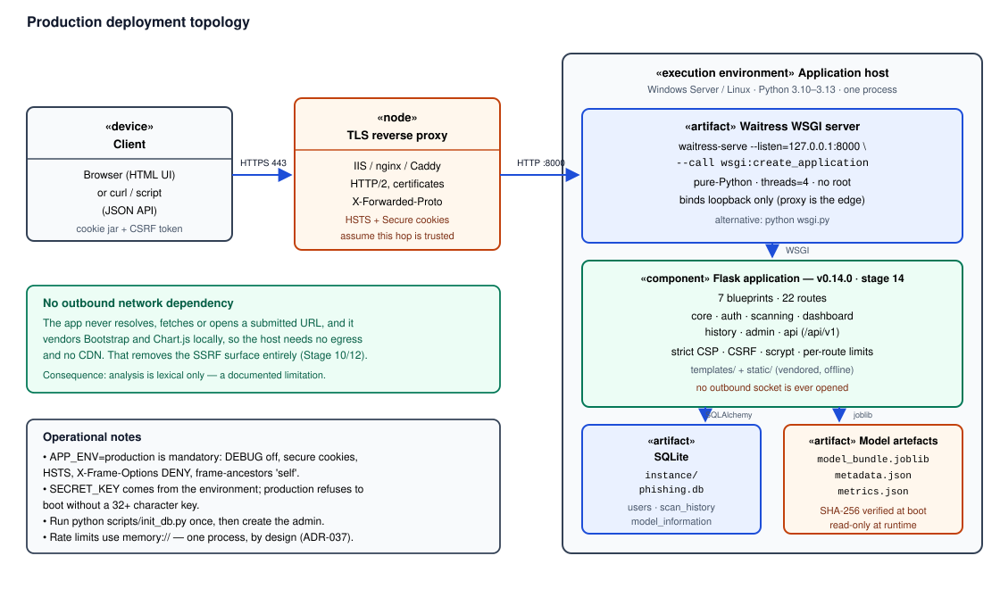

# Deployment Guide — Intelligent Phishing Website Detection System

**Scope.** This guide takes a clean checkout to a running production service and back again. It is
written for the machine that will actually host the project — a Windows workstation or a single Linux
server — with no container runtime, no external database and no outbound network access at request
time.

**Verified entry point (Stage 14 exit gate):**

```
waitress-serve --call wsgi:create_application
```

**Reference environment.** Python 3.13.16, Flask 3.1.3, scikit-learn 1.6.1, waitress, SQLite. Python
3.10+ is supported; the pinned versions in `requirements.txt` are what was measured
(`docs/ENVIRONMENT.md`).

---

## Contents

1. [Topology](#1-topology)
2. [Prerequisites](#2-prerequisites)
3. [Install](#3-install)
4. [Configure](#4-configure)
5. [Initialise the database and admin account](#5-initialise-the-database-and-admin-account)
6. [Verify the model artefacts](#6-verify-the-model-artefacts)
7. [Smoke test before going live](#7-smoke-test-before-going-live)
8. [Run in production](#8-run-in-production)
9. [Put TLS in front (reverse proxy)](#9-put-tls-in-front-reverse-proxy)
10. [Run as a service](#10-run-as-a-service)
11. [Post-deployment verification checklist](#11-post-deployment-verification-checklist)
12. [Operations](#12-operations)
13. [Upgrading and rolling back](#13-upgrading-and-rolling-back)
14. [Troubleshooting](#14-troubleshooting)
15. [Production security checklist](#15-production-security-checklist)
16. [What "deployed" means for this project](#16-what-deployed-means-for-this-project)

---

## 1. Topology



> Diagram: `docs/diagrams/deployment.svg` (offline SVG, no external assets).

```
Client ── HTTPS ──► TLS reverse proxy ── HTTP 127.0.0.1:8000 ──► waitress ──► Flask app
                                                                  │
                                                  ┌───────────────┴───────────────┐
                                                  ▼                               ▼
                                        instance/phishing.db          ml/saved_model/*.joblib
                                                                      metadata.json · metrics.json
```

Three consequences worth stating before you start:

- **One process.** Rate limits and the session store are in-process. Run **one** waitress process
  (multiple threads inside it are fine). Do not put two workers behind the proxy without moving
  limits/sessions to a shared store.
- **No egress.** The application never resolves or fetches a submitted URL, and all front-end assets
  are vendored. The host does not need outbound internet access to serve traffic. Only the one-time
  dataset download (`scripts/download_dataset.py`) and `pip install` need the network.
- **Loopback binding.** In production, bind waitress to `127.0.0.1` and let the proxy own port 443.
  Binding to `0.0.0.0` is only for the local/dev preview.

## 2. Prerequisites

| Requirement | Notes |
| --- | --- |
| Python 3.10 – 3.13 | 3.13.16 is the measured reference version |
| PowerShell 5.1+ (Windows) or a POSIX shell (Linux) | Commands for both are given |
| A writable project directory | `instance/` and `logs/` are created there |
| ~400 MB disk | Virtual environment, dataset, artefacts and the SQLite file |
| A TLS certificate (production only) | Any reverse proxy or certbot-issued certificate |
| **No** admin rights | waitress is pure Python and needs no privileged port |

Check the interpreter before anything else:

```powershell
py -3 --version          # Windows
python3 --version        # Linux / macOS
```

## 3. Install

### Windows (PowerShell)

```powershell
cd path\to\phishing-detection-system

py -3 -m venv .venv
.\.venv\Scripts\Activate.ps1
python -m pip install --upgrade pip
python -m pip install -r requirements.txt

# confirm the pinned, measured versions
python -c "import flask, sklearn, sys; print(sys.version); print('flask', flask.__version__); print('sklearn', sklearn.__version__)"
```

If PowerShell refuses to run the activation script:

```powershell
Set-ExecutionPolicy -Scope Process -ExecutionPolicy Bypass
```

### Linux / macOS

```bash
cd /opt/phishing-detection-system
python3 -m venv .venv
./.venv/bin/python -m pip install --upgrade pip
./.venv/bin/python -m pip install -r requirements.txt
./.venv/bin/python -c "import flask, sklearn; print(flask.__version__, sklearn.__version__)"
```

From here on, `python` means the interpreter **inside** the virtual environment
(`.\.venv\Scripts\python.exe` on Windows, `./.venv/bin/python` on Linux). Calling `python` outside the
environment is the single most common cause of "module not found" in this project.

## 4. Configure

Configuration comes from the environment, and a `.env` file is read with `override=False` — real
environment variables always win.

```powershell
copy .env.example .env        # Windows
cp .env.example .env          # Linux / macOS
```

Generate a key (never reuse a key from a tutorial, never commit `.env`):

```powershell
python -c "import secrets; print(secrets.token_hex(32))"
```

Production values:

```ini
APP_ENV=production
HOST=127.0.0.1
PORT=8000
SECRET_KEY=<the 64-character hex string you just generated>
LOG_LEVEL=INFO
RATE_LIMIT_SCAN=10 per minute
RATE_LIMIT_AUTH=5 per minute
RATE_LIMIT_API=30 per hour
MAX_URL_LENGTH=2048
ADMIN_USERNAME=admin
ADMIN_EMAIL=admin@your-domain.example
ADMIN_PASSWORD=
```

| Variable | Meaning | Production rule |
| --- | --- | --- |
| `APP_ENV` | Selects the config class: `development`, `testing`, `production` | **Must be `production`**; this is what turns on secure cookies, HSTS and strict proxy handling |
| `HOST` / `PORT` | Bind address for `python wsgi.py` and the `--listen` default below | `127.0.0.1` behind a proxy |
| `SECRET_KEY` | Session and CSRF signing | **Required** in production; the app refuses to start without a key of at least 32 characters. No fallback, by design |
| `LOG_LEVEL` | `DEBUG` / `INFO` / `WARNING` / `ERROR` | `INFO`; never `DEBUG` in production |
| `RATE_LIMIT_*` | Flask-Limiter expressions | Keep per-route limits; there is deliberately no blanket throttle |
| `MAX_URL_LENGTH` | Input validation ceiling | `2048` |
| `DECISION_LOW_DEFAULT` / `DECISION_HIGH_DEFAULT` | Provisional *unmeasured* band, used only if the artefact has no thresholds | Leave alone — `metadata.json` (`0.05` / `0.95`) takes precedence |
| `ADMIN_PASSWORD` | Consumed once by `scripts/create_admin.py` | Leave empty; the script prompts |
| `DATABASE_URL` | Optional absolute SQLite URL | Defaults to `instance/phishing.db` |

Harden the file permissions:

```powershell
icacls .env /inheritance:r /grant:r "$($env:USERNAME):(R,W)"    # Windows
```
```bash
chmod 600 .env                                                   # Linux / macOS
```

## 5. Initialise the database and admin account

```powershell
python scripts\init_db.py        # creates instance/phishing.db and seeds the model audit row
python scripts\create_admin.py   # prompts for a password; refuses a weak one
```

```bash
./.venv/bin/python scripts/init_db.py
./.venv/bin/python scripts/create_admin.py
```

Expected shape after both commands (also visible at `/health`):

| Table | Rows |
| --- | --- |
| `users` | 1 (the admin you just created) |
| `scan_history` | 0 on a fresh install (9 in this project's development instance) |
| `model_information` | 1 — copied from `metrics.json`, with the bundle's SHA-256 as `dataset_fingerprint` |

Do not copy a development `instance/phishing.db` into production: it carries development accounts and
test scans. Re-run `init_db.py` instead.

## 6. Verify the model artefacts

The application verifies the bundle at start-up and reports the result at `/health`:

| File | Role |
| --- | --- |
| `ml/saved_model/model_bundle.joblib` | The fitted pipeline (`StandardScaler` → `LogisticRegression`) |
| `ml/saved_model/metadata.json` | Feature order, thresholds, bundle SHA-256, limitations |
| `ml/saved_model/metrics.json` | Measured metrics — the only source of any figure the UI shows |

Manual check before starting the server:

```powershell
python -c "import hashlib,json;b=open('ml/saved_model/model_bundle.joblib','rb').read();m=json.load(open('ml/saved_model/metadata.json'));print('sha256', hashlib.sha256(b).hexdigest());print('metadata', m['model_bundle_sha256'])"
```

The two hashes must match (`841bb211…6b11dd50` for the deployed bundle). If they differ, the app reports
`503 MODEL_UNAVAILABLE` and refuses to invent a verdict — that is intended behaviour, not a fault.

Regenerate the artefacts only with the documented pipeline (`docs/TRAINING.md`,
`docs/EVALUATION.md`): `python -m ml.train_model` then `python -m ml.evaluate_model`.

## 7. Smoke test before going live

Use the development server for a two-minute functional check; it is not the production server.

```powershell
$env:APP_ENV="development"
python wsgi.py            # waitress on HOST:PORT from .env, debug off
```

In a second terminal:

```powershell
curl.exe -s http://127.0.0.1:5000/health
curl.exe -s -o NUL -w "%{http_code}`n" http://127.0.0.1:5000/
curl.exe -s -o NUL -w "%{http_code}`n" http://127.0.0.1:5000/api/v1/health
```

```bash
curl -s http://127.0.0.1:5000/health | head -c 400; echo
curl -s -o /dev/null -w "%{http_code}\n" http://127.0.0.1:5000/
```

Then in a browser: submit a URL at `/scan`, confirm the three-state result page, open `/history` after
signing in, and check `/dashboard` renders measured figures.

## 8. Run in production

```powershell
$env:APP_ENV="production"
waitress-serve --call --listen=127.0.0.1:8000 wsgi:create_application
```

```bash
APP_ENV=production ./.venv/bin/waitress-serve --call --listen=127.0.0.1:8000 wsgi:create_application
```

Without the `--listen` option the endpoint takes the waitress default (`0.0.0.0:8080`):

```
waitress-serve --call wsgi:create_application
```

**Why `--call wsgi:create_application`?** `wsgi.py` exports a factory precisely so the server can build
the application from configuration rather than import a hard-wired global. `wsgi:app` and
`wsgi:application` also work (both are exported) for servers that prefer a module attribute, e.g.
`gunicorn --bind 127.0.0.1:8000 wsgi:application` on Linux.

**Measured start-up output** (this project, verified in Stage 14):

```
[2026-11-20 20:16:32,925] INFO in app: Intelligent Phishing Website Detection System v0.14.0 | env=production | model=logistic_regression v1.0.0 | stage=14
INFO:waitress:Serving on http://127.0.0.1:8099
```

**Measured responses from that run** (headers are what production must show):

| Request | Status | Notable headers |
| --- | --- | --- |
| `GET /health` | 200 | `Server: waitress`, CSP, HSTS, `X-Frame-Options: DENY`, `X-Content-Type-Options: nosniff`, `Referrer-Policy: no-referrer` |
| `GET /api/v1/health` | 200 | same |
| `GET /api/v1/model/info` | 200 | same |
| `GET /` | 200 | same |

`/health` returned `build_stage: 14`, `version: "0.14.0"`, `bundle.detail: "bundle SHA-256 matches
metadata.json"`, `database.status: "ready"`, `detection.status: "ready"`, thresholds
`{low: 0.05, high: 0.95}`.

**Note on option order.** waitress parses the module specification positionally, so options must come
*before* it. `waitress-serve --call wsgi:create_application --listen=…` fails with
`Error: Specify one application only`. Use `waitress-serve --call --listen=… wsgi:create_application`.

## 9. Put TLS in front (reverse proxy)

The application sets `SESSION_COOKIE_SECURE`, HSTS and `X-Forwarded-Proto` handling for
`APP_ENV=production`; the proxy must therefore terminate TLS and forward the real scheme.

### nginx (Linux)

```nginx
server {
    listen 443 ssl http2;
    server_name detector.example.org;

    ssl_certificate     /etc/letsencrypt/live/detector.example.org/fullchain.pem;
    ssl_certificate_key /etc/letsencrypt/live/detector.example.org/privkey.pem;

    add_header Strict-Transport-Security "max-age=31536000; includeSubDomains" always;

    location / {
        proxy_pass         http://127.0.0.1:8000;
        proxy_set_header   Host              $host;
        proxy_set_header   X-Real-IP         $remote_addr;
        proxy_set_header   X-Forwarded-For   $proxy_add_x_forwarded_for;
        proxy_set_header   X-Forwarded-Proto $scheme;   # required for secure cookies
        proxy_read_timeout 30s;
        client_max_body_size 64k;                       # matches MAX_CONTENT_LENGTH
    }
}

server { listen 80; server_name detector.example.org; return 301 https://$host$request_uri; }
```

### IIS (Windows, ARR + URL Rewrite)

```xml
<system.webServer>
  <rewrite>
    <rules>
      <rule name="ReverseProxy" stopProcessing="true">
        <match url="(.*)" />
        <action type="Rewrite" url="http://127.0.0.1:8000/{R:1}" />
        <serverVariables>
          <set name="HTTP_X_FORWARDED_PROTO" value="https" />
        </serverVariables>
      </rule>
    </rules>
  </rewrite>
</system.webServer>
```

Both configurations expect the app on `127.0.0.1:8000`. Keep it there — an app port exposed directly to
the internet bypasses TLS, HSTS and the secure-cookie attributes.

## 10. Run as a service

### Windows — NSSM (or Task Scheduler)

```powershell
nssm install PhishingDetector "C:\path\to\phishing-detection-system\.venv\Scripts\waitress-serve.exe"
nssm set PhishingDetector AppParameters "--call --listen=127.0.0.1:8000 wsgi:create_application"
nssm set PhishingDetector AppDirectory "C:\path\to\phishing-detection-system"
nssm set PhishingDetector AppEnvironmentExtra "APP_ENV=production"
nssm set PhishingDetector Start SERVICE_AUTO_START
nssm start PhishingDetector
```

The process must run with the project directory as its working directory: relative paths
(`instance/`, `ml/saved_model/`, `.env`) are resolved from there.

### Linux — systemd

```ini
# /etc/systemd/system/phishing-detector.service
[Unit]
Description=Intelligent Phishing Website Detection System
After=network.target

[Service]
Type=simple
User=phishing
WorkingDirectory=/opt/phishing-detection-system
Environment="APP_ENV=production"
ExecStart=/opt/phishing-detection-system/.venv/bin/waitress-serve --call --listen=127.0.0.1:8000 wsgi:create_application
Restart=on-failure
RestartSec=3
NoNewPrivileges=true
PrivateTmp=true

[Install]
WantedBy=multi-user.target
```

```bash
sudo systemctl daemon-reload
sudo systemctl enable --now phishing-detector
sudo systemctl status phishing-detector
journalctl -u phishing-detector -f
```

## 11. Post-deployment verification checklist

Run these against the **public HTTPS URL** and record the results in your submission log.

| # | Check | Command | Expected |
| --- | --- | --- | --- |
| 1 | Health is ready | `curl -s https://HOST/health` | `200`, `"status": "ok"`, `bundle.available: true`, `database.status: "ready"` |
| 2 | Version and stage | `curl -s https://HOST/health` | `"version": "0.14.0"`, `"build_stage": 14` |
| 3 | API health | `curl -s https://HOST/api/v1/health` | `200`, `app_version`, `build_stage` |
| 4 | Model card | `curl -s https://HOST/api/v1/model/info` | 15 features, thresholds `0.05/0.95`, measured rows with sources |
| 5 | Security headers | `curl -sI https://HOST/` | CSP, HSTS, `X-Frame-Options: DENY`, `nosniff`, `Referrer-Policy` |
| 6 | HTTP → HTTPS | `curl -sI http://HOST/` | `301` to `https://` |
| 7 | Secure cookie | sign in, inspect the cookie | `HttpOnly`, `SameSite=Lax`, `Secure` |
| 8 | CSRF enforced | `curl -s -X POST https://HOST/api/v1/scan -H "Content-Type: application/json" -d '{"url":"https://example.com/"}'` | `400 CSRF_FAILED` |
| 9 | Rate limit | repeat a scan POST quickly | `429` with `Retry-After` |
| 10 | Anonymous admin denied | `curl -s -o /dev/null -w "%{http_code}" https://HOST/admin` | `401` (or `403` when signed in as a non-admin) |
| 11 | Static asset served locally | `curl -sI https://HOST/static/vendor/bootstrap.min.css` | `200`, no CDN host anywhere in the page source |
| 12 | No outbound fetch | scan a URL and watch the host egress | no new connections (the app never fetches the submitted URL) |

## 12. Operations

**Backup** — one file plus one directory:

```powershell
Copy-Item instance\phishing.db "backups\phishing-$(Get-Date -f yyyyMMdd-HHmm).db"
Compress-Archive ml\saved_model "backups\model-$(Get-Date -f yyyyMMdd-HHmm).zip"
```
```bash
sqlite3 instance/phishing.db ".backup 'backups/phishing-$(date +%Y%m%d-%H%M).db'"
tar czf "backups/model-$(date +%Y%m%d-%H%M).tar.gz" ml/saved_model
```

Use SQLite's `.backup` (or stop the service first) rather than copying the file while it is being
written. Restoring means putting both artefacts back: a database row whose `model_version` does not
exist in `metadata.json` is an audit inconsistency.

**Logs.** The app logs to stdout/stderr — capture it (journald on Linux, NSSM's log or a redirect on
Windows). `LOG_LEVEL=INFO` records start-up, model load verification and error paths. Never enable
`DEBUG` in production: it would expose the Werkzeug debugger.

**Rotating the secret.** Changing `SECRET_KEY` invalidates every session and CSRF token; users sign in
again. Rotate on suspicion and after any administrator departure.

**Rotating the admin password.**

```powershell
python scripts\create_admin.py --reset-password    # or re-run the interactive bootstrap
```

**Model updates.** Replace `model_bundle.joblib` + `metadata.json` + `metrics.json` together, keep the
matching bundle hash, restart the service, then confirm `/health` shows `bundle.available: true` and the
new version. Never swap the bundle while keeping the old `metadata.json` — the hash check will (correctly)
fail and every scan will return `503 MODEL_UNAVAILABLE`.

**Housekeeping.** `scan_history` grows one row per scan. At coursework volumes it is negligible; if it
grows, archive rows older than N months into a separate SQLite file rather than deleting the audit trail
outright.

## 13. Upgrading and rolling back

```powershell
# upgrade
Stop-Service PhishingDetector            # or nssm stop PhishingDetector
git pull                                  # or copy the new tree
.\.venv\Scripts\python.exe -m pip install -r requirements.txt
.\.venv\Scripts\python.exe scripts\init_db.py       # idempotent: creates missing tables, reseeds the audit row
.\.venv\Scripts\python.exe -m pytest -v             # must be 259 passed
.\.venv\Scripts\python.exe scripts\verify_stage12.py
Start-Service PhishingDetector
```

```bash
sudo systemctl stop phishing-detector
git pull && ./.venv/bin/python -m pip install -r requirements.txt
./.venv/bin/python scripts/init_db.py
./.venv/bin/python -m pytest -v
sudo systemctl start phishing-detector
```

**Rollback** = restore the previous code tree, the previous `model_bundle.joblib`/`metadata.json`/
`metrics.json`, and the database backup taken before the upgrade, then restart. `init_db.py` never drops
tables, so schema changes (there are none in this stage) would need explicit handling.

## 14. Troubleshooting

| Symptom | Cause | Fix |
| --- | --- | --- |
| `Error: Specify one application only` | `--listen` placed **after** `wsgi:create_application` | Put options before the module spec: `waitress-serve --call --listen=127.0.0.1:8000 wsgi:create_application` |
| `RuntimeError: SECRET_KEY must be set for the production configuration` | `APP_ENV=production` with an empty key | Set `SECRET_KEY` (64 hex chars) in `.env` or the environment |
| `503 MODEL_UNAVAILABLE` on every scan | Bundle missing, or hash mismatch with `metadata.json` | Re-check the SHA-256 (§6); restore a matching artefact set |
| `503 DATABASE_UNAVAILABLE` | `instance/` not writable, wrong `DATABASE_URL`, or schema not created | Run `scripts/init_db.py`; check directory permissions |
| `429 RATE_LIMITED` immediately after start | Old in-memory counters do not exist, but a browser is repeating a POST | Wait for the window, or send the CSRF token correctly |
| `400 CSRF_FAILED` from curl | No `X-CSRF-Token` header | `GET /api/v1/csrf-token` first, then POST with the returned token and the session cookie |
| Login redirects in a loop behind HTTPS | Proxy not sending `X-Forwarded-Proto` | Add the header (§9); secure cookies are rejected over plain HTTP |
| `ModuleNotFoundError` | Script run with the system Python | Use `.\.venv\Scripts\python.exe` / `./.venv/bin/python` |
| Port already in use | Another instance running | `Get-NetTCPConnection -LocalPort 8000` / `ss -ltnp \| grep 8000`, then stop it |
| Charts blank on the dashboard | Vendor asset missing or altered | Restore `static/vendor/*` (hashes are asserted by Gate 12) |

## 15. Production security checklist

- [ ] `APP_ENV=production` and `DEBUG` off (verify `debug=False` in the start-up log line).
- [ ] `SECRET_KEY` set from the environment, 32+ characters, not committed anywhere.
- [ ] `.env` untracked (`git check-ignore -v .env`) with restrictive permissions.
- [ ] Waitress bound to `127.0.0.1`, reached only through the TLS proxy.
- [ ] HTTPS redirect in place; HSTS present on responses.
- [ ] Secure, `HttpOnly`, `SameSite=Lax` session cookie observed in a real browser.
- [ ] CSP served as configured — no CDN hosts in the rendered HTML.
- [ ] Admin password changed from any default; weak passwords rejected by the script.
- [ ] Per-route rate limits active (`429` + `Retry-After` observed).
- [ ] Backups of `instance/phishing.db` and `ml/saved_model/` taken and **tested** by restoring.
- [ ] Logs retained and reviewed; no submitted URL is echoed into logs at `INFO`.
- [ ] `/health` green after every restart; `bundle.available: true`.

## 16. What "deployed" means for this project

The Stage 14 exit gate is a clean production start, verified by:

```powershell
.\.venv\Scripts\waitress-serve.exe --call --listen=127.0.0.1:8000 wsgi:create_application
```
```bash
./.venv/bin/waitress-serve --call --listen=127.0.0.1:8000 wsgi:create_application
```

with these observed results (Stage 14, `APP_ENV=production`):

| Gate element | Observed |
| --- | --- |
| Server starts with no traceback | ✅ one `INFO` line, then `INFO:waitress:Serving on http://127.0.0.1:8099` |
| Reports the deployed stage | ✅ `v0.14.0 … stage=14` |
| Model bundle verified, not assumed | ✅ `bundle SHA-256 matches metadata.json` |
| Database reachable and seeded | ✅ `database.status: "ready"`, 3 tables, `model_information: 1` |
| Detection engine ready with measured thresholds | ✅ `0.05 < p < 0.95` |
| Security headers present in production | ✅ CSP, HSTS, `X-Frame-Options: DENY`, `nosniff`, `Referrer-Policy` |
| No outbound connection is ever made | ✅ by construction and asserted by the gates |

A deployment that satisfies §11 is reproducible from a clean checkout in the order given in this
document. Anything less is a development server with a production label.
